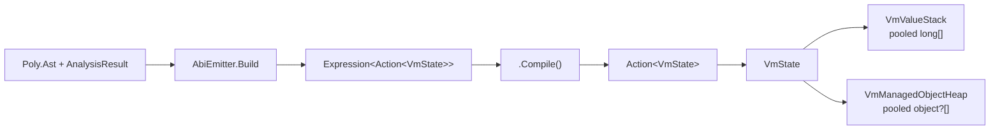

# VM Execution Engine (Interpretation/Vm/)

The VM compiles an analyzed AST directly into a LINQ `Expression<Action<VmState>>`,
compiles that to a delegate, and runs it against `VmState`. There is no bytecode and
no intermediate primitive IR.

## Layout at a glance



```text
VmState
├─ Stack : VmValueStack        long[] RawSlots; int StackPointer     (ArrayPool<long>)
├─ Heap  : VmManagedObjectHeap object?[] _objects; free list          (ArrayPool<object?>)
├─ FramePos                    first argument / result slot
├─ ClosureHandle               active closure array
├─ Status, ProgramCounter      running / suspended / resuming
└─ DebugHook                   optional per-statement callback
```

The compiled delegate keeps the hot state in locals:

| Local | Meaning |
|-------|---------|
| `_slots` | `state.Stack.RawSlots` — frame slots (arguments, locals, result) |
| `_fp` | `FramePos` — first argument slot of the current frame |
| `_heap` | `state.Heap` |
| `_this` | `_slots[_fp]` — instance handle for the frame |
| `_regN` | register-backed local variables (`_reg0`, `_reg1`, …), created on demand |
| `_rN` | ring slots for expression evaluation (`_r0`, `_r1`, …) |

Ring slots are ordinary CLR locals, so the JIT enregisters them; the ring is a
compile-time naming discipline, not a runtime stack. Frame slots are only written
for values that outlive an expression (arguments, spilled locals, the result), and
for the debug hook's local span.

### Storage locations

A value has one representation (a `long` slot, inline word or heap handle) but
lives in one of four places. `SlotLocation` names them, and a read or a write is
one call instead of a per-site branch:

| Location | Address | Used for |
|----------|---------|----------|
| `Ring` | `_rN` | transient expression-stack values |
| `Frame` | `_slots[_fp + n]` | a local, a parameter, the result slot |
| `Local` | a CLR local | a `_regN` register, `_this` |
| `Cell` | `long[1]` element 0 | a capture cell, reached through a closure array or a slot handle |

`Context.Resolve` is the one binding resolver: a closure capture cell first, then
the bound-parameter / register / frame-slot ladder, wrapping a cell-backed local
in its cell. `VariableReadRaw`/`VariableWriteRaw` resolve the binding's own
storage without the capture indirection.

Shape is `RingCodec`'s job and is not stored on the location. Two classifiers
answer two different questions: `RingCodec.UnderlyingKindFor` asks whether a
type's *underlying* value is long-representable (it peels a nullable), while
`ValueRepresentationClassifier.KindFor` asks what a *node* of that type puts in
its slot (a nullable is a heap handle).

### Where a result lives

`CompileNode` returns a `CompiledNode`: the code, and the `SlotLocation` its result
occupies once that code has run. Naming the location is what lets a consumer
release it, so the ring is a pool of result locations rather than an ambient
cursor that every consumer re-derived as `RingDepth - 1`.

- An expression leaves its result at the top of the ring, which is where
  `CompiledNode.Result` points.
- A node whose value leaves through another channel — a `return` inside an inlined
  arm, or a statement with no value — reports no result, and `RequireResult` fails
  closed for a consumer that needs one.
- A block compiles each statement from the block's entry depth, so the ring
  high-water is the deepest statement, not the sum of all of them. A comment or a
  label emits nothing, so it must not release the pending result:
  `[return 7, comment]` still yields 7.
- An emitter that compiles a sub-expression and discards its slots holds a
  `Context.RingScope`: `using var scope = ctx.OpenRingScope();` for a whole body, or
  a `using (…)` block around one compile. Disposal restores the depth, so an
  alternate arm, a loop body, or a bridge handle cannot leak slots into the
  enclosing region, and nothing writes the cursor back by hand.

Before this, `RingDepth` was never reset between statements. nqueens emitted 23
ring locals for a body whose deepest statement needs 13.

## What the emitted body looks like

Worked example: `var x = 2; x + 1` (a block with one local and one expression).
The body below is the actual tree from `AbiEmitter.Build`, with empty
`default(void)` dispatch nodes elided.

### `NoDebug`

```csharp
(VmState state) =>
{
    long[] _slots = state.Stack.RawSlots;
    VmManagedObjectHeap _heap = state.Heap;
    int _fp = state.Status == InterpreterStatus.Resuming
        ? state.FramePos : 0;
    long _this = _slots[_fp];

    long _reg0 = 0;          // x
    long _r0, _r1;

_entry:
    _r0 = 2;                 // x = 2
    _reg0 = _r0;
    _r1 = _reg0 + 1;         // x + 1
    _slots[_fp + 0] = _reg0; // block-exit snapshot for VmDebugger.GetLocals
    _slots[_fp] = _r1;       // publish the result at FramePos
    state.Stack.StackPointer = _fp + 1;
_exit:
}
```

### `Normal` (default)

```csharp
(VmState state) =>
{
    long[] _slots = state.Stack.RawSlots;
    VmManagedObjectHeap _heap = state.Heap;
    int _fp = state.Status == InterpreterStatus.Resuming
        ? state.FramePos : 0;
    long _this = _slots[_fp];

    long _reg0 = 0;          // x
    long _r0, _r1;

_entry:
    // root statement (the block)
    if (state.DebugHook != null) {
        state.CurrentAstNode = <block>;
        state.DebugHook(<block>,
            new ReadOnlySpan<long>(_slots, _fp, 1), _heap);
    }

    _reg0 = 0;

    // x = 2
    if (state.DebugHook != null) {
        _slots[_fp + 0] = _reg0;          // EmitScopeStores
        state.CurrentAstNode = <x = 2>;
        state.DebugHook(<x = 2>,
            new ReadOnlySpan<long>(_slots, _fp, 1), _heap);
    }
    _r0 = 2;
    _reg0 = _r0;

    // x + 1
    if (state.DebugHook != null) {
        _slots[_fp + 0] = _reg0;
        state.CurrentAstNode = <x + 1>;
        state.DebugHook(<x + 1>,
            new ReadOnlySpan<long>(_slots, _fp, 1), _heap);
    }
    _r1 = _reg0 + 1;

    // block-exit snapshot: unconditional, because VmDebugger.GetLocals reads it
    // after execution even when no hook was attached
    _slots[_fp + 0] = _reg0;

    _slots[_fp] = _r1;
    state.Stack.StackPointer = _fp + 1;
_exit:
}
```

`Normal` adds, per statement, the scope stores (register-backed locals mirrored
into frame slots), `CurrentAstNode`, and the guarded `DebugHook` call. `NoDebug`
emits none of that. The per-statement stores sit **inside** the hook guard because
their only consumer is the hook's `ReadOnlySpan<long>`. The block-exit snapshot is
the exception: it stays unconditional so `VmDebugger.GetLocals` can read the frame
after execution even when no hook was attached. Slot-backed variables already live
in `_slots`; register-backed ones read/write `_regN`.

The tree shape of one guarded statement:

```text
IfThen(
  NotEqual(state.DebugHook, null),
  Block(
    Block(Assign(_slots[_fp + 0], _reg0)),
    Assign(state.CurrentAstNode, Constant(node)),
    Invoke(state.DebugHook, Constant(node),
           New(ReadOnlySpan<long>(_slots, _fp, 1)), _heap)))
```

A body containing a `SuspendNode` additionally emits a resume dispatch at the entry:

```csharp
if (state.Status == InterpreterStatus.Resuming)
    switch (state.ProgramCounter) {
        case 0: goto resume_0;
        ...
        default: goto _exit;
    }
```

## Pipeline

```text
Analyzed AST → AbiEmitter.Build → Expression<Action<VmState>> → .Compile()
            → VmProgram → Interpreter.Execute → ExecutionResult
```

`AbiEmitter.Build` is internal and returns the expression plus its metadata
(`BuiltVmProgram`); `AbiEmitter.Emit` compiles it into the `VmProgram` delegate.
The VM README's examples are built from that expression.

## File Map

| File | Purpose |
|------|---------|
| `Abi/AbiEmitter.cs` | **Primary compiler**: walks analyzed AST, builds the `Action<VmState>` lambda |
| `Abi/AbiEmitter.Context.cs` | Compilation context (ring, frames, scopes) |
| `Abi/AbiEmitter.Expressions.cs` | Arithmetic, comparison, logic, members, types |
| `Abi/AbiEmitter.Statements.cs` | Assignment, blocks, branches, loops, EH, return |
| `Abi/AbiEmitter.Invoke.cs` | Invoke, lambda bodies, instance dispatch |
| `Abi/RingCodec.cs` | The ABI codec: value classification and both-direction conversion |
| `Abi/ValueRepresentation.cs` | Emit-time slot-kind classification from the effective node's type |
| `VmState.cs` | Per-execution state: stack, heap, frame, debug hook, loop limits |
| `VmProgram.cs` | Compiled program record (delegate + max ring depth + debug metadata) |
| `VmValueStack.cs` | Pooled `long[]` stack backed by `ArrayPool<long>.Shared` |
| `VmManagedObjectHeap.cs` | Pooled object heap for reference-type values with free-list recycling |
| `CompilationMode.cs` | `Normal` (debug hook + resume) vs `NoDebug` |
| `Ref.cs` (in `Poly/Introspection/CommonLanguageRuntime`) | Compile-time `MemberInfo` lookups (`Ref.Method`, `Ref<T>.Property`, …). Use these; do not add `typeof(T).GetMethod(...)` |
| `VmCall.cs` | The one call-frame protocol (2-word header, frame pointer, result slot) |

## Runtime Types

### `RingCodec`
The single definition of the VM's long-slot ABI. Classifies a value as an inline
word (number, boolean 0/non-zero, IEEE bit pattern) or a heap handle (`KindFor`,
`IsInline`, `IsIeee`), and converts in both directions — compile-time
`Expression` factories (`FromClr`, `ToClr`, `Box`) and runtime helpers (`ToRing`,
`Cast`, `TypeAs`, `UnboxNullable`) called by emitted code.

### `VmCall`
The one call-frame protocol. A frame is a 2-word header (previous frame pointer,
saved stack pointer) then argument slots; `FramePos` is the first argument slot,
a parameter is read at `FramePos + index`, and the callee result is written to
`slots[FramePos]`. `Invoke` runs a function in a new frame and restores FP,
closure, and SP even when the body throws.

### `VmValueStack`
Pooled `long[]` stack backed by `ArrayPool<long>.Shared`. Grows by doubling,
`SetStackPointer` grows on demand, and `Dispose` returns the buffer cleared.
`Push`/`Pop`/`Drop` are aggressively inlined; `RawSlots` is the frame-slot array
the emitted body reads and writes.

### `VmManagedObjectHeap`
Contiguous object store indexed by handles, rented from `ArrayPool<object?>.Shared`.
Handle 0 is the ABI null/falsy sentinel (never allocated). The free-list recycles
handles of set-to-null objects. Grows by doubling; `Dispose` returns the buffer
cleared, so a short-lived execution allocates no heap buffer. Methods: `Allocate`,
`Get`, `Set`, `UnsafeGet`, `UnsafeSet`, `Clear`.

### `VmDebugger`
High-level step debugger:
- `Start()` — begin execution, pause at first statement
- `StepOver()` — advance one statement boundary
- `Continue()` — run to completion
- `CurrentNode` / `CurrentLocals` — inspect the current position

Uses a background thread with blocking hooks. Zero overhead when not stepping.

## Debug Hooks

| Hook | Signature | When Called | Overhead When Null |
|------|-----------|-------------|-------------------|
| `DebugHook` | `Action<Node, ReadOnlySpan<long>, VmManagedObjectHeap>?` | Before each statement in `Normal` (`CompileStatement`) | Single null check |

`DebugHook` fires for the program root and each `Block` child. The span covers the
current frame's slots, and the scope stores immediately before it make
register-backed locals current. `NoDebug` does not emit the hook, the
`CurrentAstNode` assignment, or the scope stores.

## Value Marshalling

`RingCodec` converts between VM representation (`long` words, heap handles) and
CLR types. `AbiEmitter` uses `FromClr` / `ToClr` when emitting external
method and constructor calls; the emitted runtime helpers are `ToRing` (`object`
→ ring) and `Cast` / `TypeAs` / `UnboxNullable`.

Stack scalars widen through `Convert`, booleans use `!= 0`, float and double use
IEEE bit patterns, and heap references allocate through
`VmManagedObjectHeap.Allocate` or dereference via `VmManagedObjectHeap.UnsafeGet`.

## Key Design Decisions

- **Ring locals, not an evaluation stack**: values flow through `_r0.._rN` CLR
  locals allocated inline during the AST walk; no global allocator pass and no
  runtime push/pop for expression evaluation.
- **Frame slots for what outlives an expression**: arguments, spilled locals, and
  the result live in `_slots[_fp + n]`; register-backed locals are mirrored there
  only when the debug hook needs the span.
- **Pooled buffers**: `VmValueStack` and `VmManagedObjectHeap` rent their backing
  arrays, so short-lived executions do not allocate them.
- **Compiled delegates**: the emitter builds a LINQ expression and compiles it to
  `Action<VmState>`; no bytecode, no dispatch loop. Resume dispatch on
  `state.ProgramCounter` exists only when a `SuspendNode` registered a step.
- **Native control flow and EH**: loops, branches, and try/catch/finally use CLR
  `Loop`, `Condition`, `Goto`, and `TryCatchFinally` nodes.

## VM ABI: Call Frame Layout

Defined once in `VmCall`. A frame is a 2-word header followed by argument slots:

```text
Slot[callSp + 0]:  previous FP
Slot[callSp + 1]:  saved SP
Slot[callSp + 2]:  arg0            ← FramePos (FP)
Slot[callSp + 3]:  arg1
...
Slot[FP + n]:      result          (written by the callee)
```

`VmCall.Invoke` sets `FramePos = FramePointer(callSp)` (the first argument slot),
runs the callee, reads the result from `slots[FramePos]`, then restores FP, the
closure handle, and the stack pointer. A parameterless callee still reserves one
argument slot so its result has somewhere to go (`ArgumentSlots`).

Inside a compiled function body, `FramePos` is the first argument slot: a
parameter resolves at `FramePos + index` and `return` writes `slots[FramePos]`
then sets `SP = FramePos + 1`.
