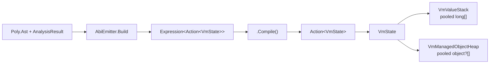

# VM Execution Engine (Interpretation/Vm/)

The VM compiles an analyzed AST directly into a LINQ `Expression<Action<VmState>>`,
compiles that to a delegate, and runs it against `VmState`. There is no bytecode and
no intermediate primitive IR.

## Layout at a glance



```text
VmState
├─ Stack : VmValueStack        long[] RawSlots; int StackPointer     (ArrayPool<long>)
├─ Heap  : VmManagedObjectHeap object?[] _objects; free list          (ArrayPool<object?>)
├─ FramePos                    first argument / result slot
├─ ClosureHandle               active closure array
├─ Status, ProgramCounter      running / suspended / resuming
└─ DebugHook                   optional per-statement callback
```

The compiled delegate keeps the hot state in locals:

| Local | Meaning |
|-------|---------|
| `_slots` | `state.Stack.RawSlots` — frame slots (arguments, locals, result) |
| `_fp` | `FramePos` — first argument slot of the current frame |
| `_heap` | `state.Heap` |
| `_this` | `_slots[_fp]` — instance handle for the frame |
| pool locals | one `LocalPool` cursor for variable leases, expression temps, and named helpers |

Pool locals are ordinary CLR locals, so the JIT enregisters them. The pool is a
compile-time naming discipline, not a runtime stack. A local's name is its
`LocalType`: `_dN` double, `_fN` float, `_iN` int, `_nN_T` nullable, and `_rN`
for every other word. A variable takes the next free lease (at most 32 live).
Past that it lives only in its frame slot. Temps and helpers (`_coal`, `_shift`,
`_callSp`, `_callerFp`) sit above the leases that are still live.

Frame slots are the observation copy, not the variable's home. A write assigns
the lease. The lease is stored into `_slots[_fp + n]` only at an observation:
the debug hook (which carries the block-exit and catch-exit copies) while a hook
is attached, and a suspend spill. Arguments and the result are frame slots too.

### Storage locations

A value has one `LocalType` and lives in one of four places. `SlotLocation` names
them. There is no `View`: a typed read of a stored word is `LocalType.FromWord`,
and a typed write is `Encode`.

| Location | Address | Used for |
|----------|---------|----------|
| `Ring` | a pool index | a temp whose home is the ring cursor |
| `Frame` | `_slots[_fp + n]` | a local, a parameter, the result slot |
| `Local` | a CLR local | a variable lease, a helper, `_this` |
| `Cell` | `long[1]` element 0 | a capture cell, reached through a closure array or a slot handle |

`Context.Resolve` is the one binding resolver: a closure capture cell first, then
the bound parameter, then the variable's lease, then its frame slot when it has
no lease. A cell-backed local is wrapped in its cell. The lease holds the cell's
handle, never `cell[0]`. `VariableReadRaw`/`VariableWriteRaw` resolve the
binding's own storage without the capture indirection.

`Value` is a placed result: `Code` runs, `Read` names the value after it runs,
`Place` is the `SlotLocation`, and `Type` is its `LocalType`.
`EmitScope.Yield` spills a computation into the next pool local and returns
that assignment. The scope's dispose rewinds anything that was not yielded.

Shape is `RingCodec`'s job and is not stored on the location.
`ValueRepresentationClassifier.KindFor` is the one classifier: what a node of a
type puts in its slot. A nullable is `HeapRef` — its frame word is a boxed
`Nullable<T>`, and 0 is absent — while its pool local is typed `Nullable<T>`
(`_nN_T`, `SlotType` is the nullable itself), so the value is never read as a
word. There is no second "underlying" classifier; arithmetic on a nullable
lifts to its underlying type, and the slot stays the typed local.

### Where a result lives

`CompileNode` returns a `Value`: the code, the read, and the `SlotLocation` its
result occupies once that code has run. Naming the location is what lets a consumer
release it, so the ring is a pool of result locations rather than an ambient
cursor that every consumer re-derived as `RingDepth - 1`.

- An expression leaves its result at the top of the ring, which is where
  `Value.Place` points and `Value.Read` reads it.
- A node whose value leaves through another channel — a `return` inside an inlined
  arm, or a statement with no value — reports no result, and `RequireResult` fails
  closed for a consumer that needs one.
- A block compiles each statement from the block's entry depth, so the ring
  high-water is the deepest statement, not the sum of all of them. A comment or a
  label emits nothing, so it must not release the pending result:
  `[return 7, comment]` still yields 7.
- An emitter that compiles a sub-expression and discards its slots holds a
  `Context.RingScope`: `using var scope = ctx.OpenRingScope();` for a whole body, or
  a `using (…)` block around one compile. Disposal restores the depth, so an
  alternate arm, a loop body, or a bridge handle cannot leak slots into the
  enclosing region, and nothing writes the cursor back by hand.

Before this, `RingDepth` was never reset between statements. nqueens emitted 23
ring locals for a body whose deepest statement needs 13.

## What the emitted body looks like

Worked example: `var x = 2; x + 1` (a block with one local and one expression).
The body below is the shape `AbiEmitter.Build` emits, with empty `default(void)`
dispatch nodes elided. `x` is the lease `_r0`. The assignment and the add use
temps from the same pool.

### `NoDebug`

```csharp
(VmState state) =>
{
    long[] _slots = state.Stack.RawSlots;
    VmManagedObjectHeap _heap = state.Heap;
    int _fp = state.Status == InterpreterStatus.Resuming
        ? state.FramePos : 0;
    long _this = _slots[_fp];

    long _r0 = 0;            // x, the variable lease
    long _r1, _r2, _r3;      // temps above the lease

_entry:
    _r1 = 2;                 // x = 2
    _r0 = _r1;               // a write assigns the lease
    _r3 = _r0 + 1;           // x + 1
    _slots[_fp] = _r3;       // publish the result at FramePos
    state.Stack.StackPointer = _fp + 1;
_exit:
}
```

### `Normal` (default)

```csharp
(VmState state) =>
{
    long[] _slots = state.Stack.RawSlots;
    VmManagedObjectHeap _heap = state.Heap;
    int _fp = state.Status == InterpreterStatus.Resuming
        ? state.FramePos : 0;
    long _this = _slots[_fp];

    long _r0 = 0;            // x, the variable lease
    long _r1, _r2, _r3;

_entry:
    // root statement (the block)
    if (state.DebugHook != null) {
        state.CurrentAstNode = <block>;
        state.DebugHook(<block>,
            new ReadOnlySpan<long>(_slots, _fp, 1), _heap);
    }

    _r0 = 0;

    // x = 2
    if (state.DebugHook != null) {
        _slots[_fp + 0] = _r0;            // observation copy for the hook span
        state.CurrentAstNode = <x = 2>;
        state.DebugHook(<x = 2>,
            new ReadOnlySpan<long>(_slots, _fp, 1), _heap);
    }
    _r1 = 2;
    _r0 = _r1;

    // x + 1
    if (state.DebugHook != null) {
        _slots[_fp + 0] = _r0;
        state.CurrentAstNode = <x + 1>;
        state.DebugHook(<x + 1>,
            new ReadOnlySpan<long>(_slots, _fp, 1), _heap);
    }
    _r3 = _r0 + 1;

    // block-exit snapshot, same guard as the per-statement copy
    if (state.DebugHook != null) {
        _slots[_fp + 0] = _r0;
    }

    _slots[_fp] = _r3;
    state.Stack.StackPointer = _fp + 1;
_exit:
}
```

`Normal` adds, per statement, the observation copy inside the hook guard,
`CurrentAstNode`, and the guarded `DebugHook` call. `NoDebug` emits none of that.
The per-statement copy and the block-exit copy both sit **inside** the hook guard.
Their consumer is the hook's `ReadOnlySpan<long>`, and `VmDebugger.GetLocals` after
a run that had a hook attached. A catch copies the same way when the catch body
ends. `NoDebug` emits none of these copies. A variable with no lease already lives
in `_slots`; a lease is read and written in place.

A `SuspendNode` spills each live lease, each enclosing temp still needed after
resume, and each helper assigned before the suspend and read after it. The store
is the frame encoding of the local (a cell spills its handle, not `cell[0]`).
The reload is the first expression after the resume label, before the suspended
flag is cleared. A binding whose only home is already a frame word is not spilled.

The tree shape of one guarded statement:

```text
IfThen(
  NotEqual(state.DebugHook, null),
  Block(
    Block(Assign(_slots[_fp + 0], _r0)),
    Assign(state.CurrentAstNode, Constant(node)),
    Invoke(state.DebugHook, Constant(node),
           New(ReadOnlySpan<long>(_slots, _fp, 1)), _heap)))
```

A body containing a `SuspendNode` additionally emits a resume dispatch at the entry:

```csharp
if (state.Status == InterpreterStatus.Resuming)
    switch (state.ProgramCounter) {
        case 0: goto resume_0;
        ...
        default: goto _exit;
    }
```

## Pipeline

```text
Analyzed AST → AbiEmitter.Build → Expression<Action<VmState>> → .Compile()
            → VmProgram → Interpreter.Execute → ExecutionResult
```

`AbiEmitter.Build` is internal and returns the expression plus its metadata
(`BuiltVmProgram`); `AbiEmitter.Emit` compiles it into the `VmProgram` delegate.
The VM README's examples are built from that expression.

## File Map

| File | Purpose |
|------|---------|
| `Abi/AbiEmitter.cs` | **Primary compiler**: walks analyzed AST, builds the `Action<VmState>` lambda |
| `Abi/AbiEmitter.Context.cs` | Compilation context (ring, frames, scopes) |
| `Abi/AbiEmitter.Expressions.cs` | Arithmetic, comparison, logic, members, types |
| `Abi/AbiEmitter.Statements.cs` | Assignment, blocks, branches, loops, EH, return |
| `Abi/AbiEmitter.Invoke.cs` | Invoke, lambda bodies, instance dispatch |
| `Abi/RingCodec.cs` | The ABI codec: value classification and both-direction conversion |
| `Abi/ValueRepresentation.cs` | Emit-time slot-kind classification from the effective node's type |
| `VmState.cs` | Per-execution state: stack, heap, frame, debug hook, loop limits |
| `VmProgram.cs` | Compiled program record (delegate + max ring depth + debug metadata) |
| `VmValueStack.cs` | Pooled `long[]` stack backed by `ArrayPool<long>.Shared` |
| `VmManagedObjectHeap.cs` | Pooled object heap for reference-type values with free-list recycling |
| `CompilationMode.cs` | `Normal` (debug hook + resume) vs `NoDebug` |
| `Ref.cs` (in `Poly/Introspection/CommonLanguageRuntime`) | Compile-time `MemberInfo` lookups (`Ref.Method`, `Ref<T>.Property`, …). Use these; do not add `typeof(T).GetMethod(...)` |
| `VmCall.cs` | The one call-frame protocol (2-word header, frame pointer, result slot) |

## Runtime Types

### `RingCodec`
The single definition of the VM's long-slot ABI. Classifies a value as an inline
word (number, boolean 0/non-zero, IEEE bit pattern) or a heap handle (`KindFor`,
`IsInline`, `IsIeee`), and converts in both directions — compile-time
`Expression` factories (`FromClr`, `ToClr`, `Box`) and runtime helpers (`ToRing`,
`Cast`, `TypeAs`, `UnboxNullable`) called by emitted code.

### `VmCall`
The one call-frame protocol. A frame is a 2-word header (previous frame pointer,
saved stack pointer) then argument slots; `FramePos` is the first argument slot,
a parameter is read at `FramePos + index`, and the callee result is written to
`slots[FramePos]`. `Invoke` runs a function in a new frame and restores FP,
closure, and SP even when the body throws.

An `Invoke` overload takes the frame's words one at a time (`Invoke(state,
function, long a0, …)`). The emitter calls those for any frame of eight words or
fewer, so a call site allocates nothing to make the call; a wider frame keeps the
`ReadOnlySpan<long>` form, which is the same protocol with different plumbing.

The restore is a catch-and-rethrow, not a `try`/`finally`. A `finally` is emitted
as a funclet call on the normal path — a second prologue and epilogue per frame —
whereas the catch only costs anything when something throws.

### A rejected body fails closed

A resolved AST method with a body must compile. When it does not — a lambda inside an
AST method, an unresolvable member in the body, a wrong-arity call — the reject is never
silently replaced by a name-dispatched host call:

- **Receiver is an instance the VM constructs** (`new T()` for an AST type): there is no
  host object to dispatch to — the runtime object is the VM's own dictionary, which has
  none of `T`'s methods — so emission throws, naming the method and the reject. It used to
  run to `Type 'Dictionary\`2' does not define method '…'` at *runtime*, which names the
  storage type instead of the cause.
- **Any other receiver** (a parameter or `this` that a host may fill with an object that
  really implements the method): the `GetMethods` / `InvokeNamed` fallback stays, and the
  failure now carries the reject as a trailing clause, so the reason travels with the
  symptom.

Type inference for an unresolved invoke also refuses to reflect over an AST type's runtime
type: that is the VM's storage (a dictionary), not the API the program calls, so it could
only invent a signature the type does not have.

### `VmValueStack`
Pooled `long[]` stack backed by `ArrayPool<long>.Shared`. Grows by doubling,
`SetStackPointer` grows on demand, and `Dispose` returns the buffer cleared.
`Push`/`Pop`/`Drop` are aggressively inlined; `RawSlots` is the frame-slot array
the emitted body reads and writes.

### `VmManagedObjectHeap`
Contiguous object store indexed by handles, rented from `ArrayPool<object?>.Shared`.
Handle 0 is the ABI null/falsy sentinel (never allocated). The free-list recycles
handles of set-to-null objects. Grows by doubling; `Dispose` returns the buffer
cleared, so a short-lived execution allocates no heap buffer. Methods: `Allocate`,
`Get`, `Set`, `UnsafeGet`, `UnsafeSet`, `Clear`.

### `VmDebugger`
High-level step debugger:
- `Start()` — begin execution, pause at first statement
- `StepOver()` — advance one statement boundary
- `Continue()` — run to completion
- `CurrentNode` / `CurrentLocals` — inspect the current position

Uses a background thread with blocking hooks. Zero overhead when not stepping.

## Debug Hooks

| Hook | Signature | When Called | Overhead When Null |
|------|-----------|-------------|-------------------|
| `DebugHook` | `Action<Node, ReadOnlySpan<long>, VmManagedObjectHeap>?` | Before each statement in `Normal` (`CompileStatement`) | Single null check |

`DebugHook` fires for the program root and each `Block` child. The span covers the
current frame's slots, and the scope stores immediately before it make
the live leases current in that span. `NoDebug` does not emit the hook, the
`CurrentAstNode` assignment, or the lease copies. Block exit and catch exit use
the same null check.

## Value Marshalling

`RingCodec` converts between VM representation (`long` words, heap handles) and
CLR types. `AbiEmitter` uses `FromClr` / `ToClr` when emitting external
method and constructor calls; the emitted runtime helpers are `ToRing` (`object`
→ ring) and `Cast` / `TypeAs` / `UnboxNullable`.

Stack scalars widen through `Convert`, booleans use `!= 0`, float and double use
IEEE bit patterns, and heap references allocate through
`VmManagedObjectHeap.Allocate` or dereference via `VmManagedObjectHeap.UnsafeGet`.

## Key Design Decisions

- **Ring locals, not an evaluation stack**: values flow through `_r0.._rN` CLR
  locals allocated inline during the AST walk; no global allocator pass and no
  runtime push/pop for expression evaluation.
- **Frame slots are observation copies**: arguments and the result live in
  `_slots[_fp + n]`. A variable lease is copied there by the debug hook (which
  carries the block-exit and catch-exit copies) and at a suspend spill. A write
  does not copy.
- **Pooled buffers**: `VmValueStack` and `VmManagedObjectHeap` rent their backing
  arrays, so short-lived executions do not allocate them.
- **Compiled delegates**: the emitter builds a LINQ expression and compiles it to
  `Action<VmState>`; no bytecode, no dispatch loop. Resume dispatch on
  `state.ProgramCounter` exists only when a `SuspendNode` recorded a step.
- **Native control flow and EH**: loops, branches, and try/catch/finally use CLR
  `Loop`, `Condition`, `Goto`, and `TryCatchFinally` nodes.

## VM ABI: Call Frame Layout

Defined once in `VmCall`. A frame is a 2-word header followed by argument slots:

```text
Slot[callSp + 0]:  previous FP
Slot[callSp + 1]:  saved SP
Slot[callSp + 2]:  arg0            ← FramePos (FP)
Slot[callSp + 3]:  arg1
...
Slot[FP + n]:      result          (written by the callee)
```

`VmCall.Invoke` sets `FramePos = FramePointer(callSp)` (the first argument slot),
runs the callee, reads the result from `slots[FramePos]`, then restores FP, the
closure handle, and the stack pointer. A parameterless callee still reserves one
argument slot so its result has somewhere to go (`ArgumentSlots`).

The words reach `Invoke` as parameters rather than as a `long[]`: the emitter calls
one `InvokeAstFrame` overload per arity up to eight words, and only a wider frame
falls back to the array form. The layout above is identical either way — the array
was plumbing, not protocol.

Inside a compiled function body, `FramePos` is the first argument slot: a
parameter resolves at `FramePos + index` and `return` writes `slots[FramePos]`
then sets `SP = FramePos + 1`.
