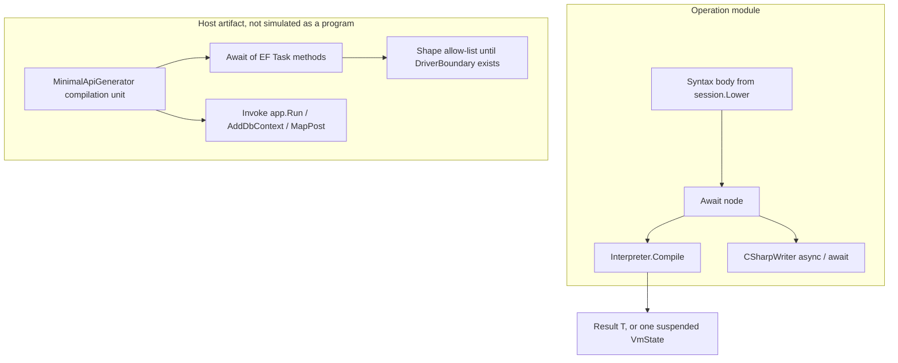
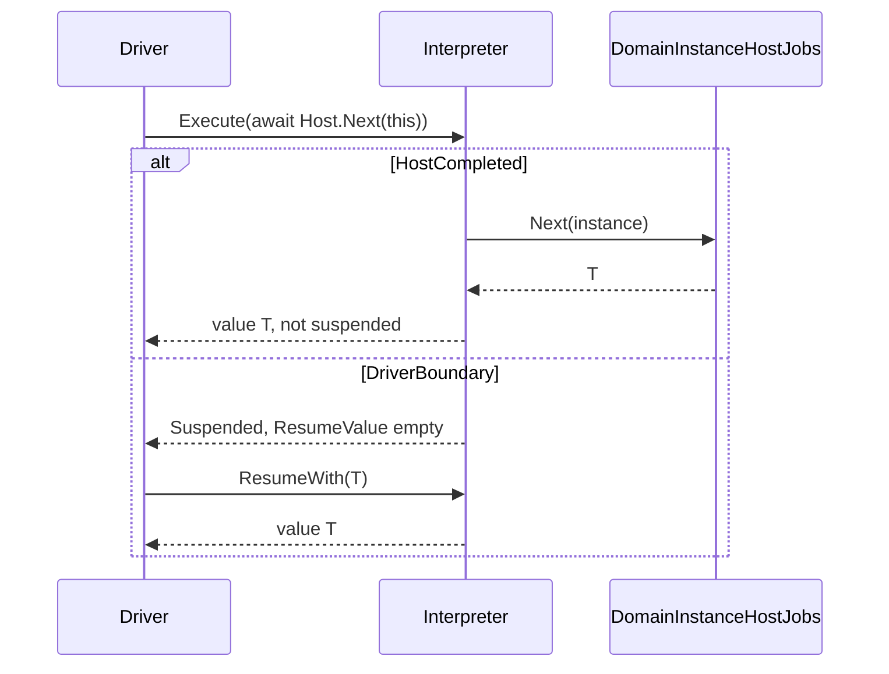

# ADR: Async/await in the interpreter

**Date:** 2026-10-15
**Status:** Proposed
**Author:** design spike
**Deciders:** product owner (not yet accepted)

**Home:** `docs/decisions/2026-10-15-async-await-in-the-interpreter.md`

**Companion (part 2):** [`2026-10-16-async-interpreter-execution.md`](2026-10-16-async-interpreter-execution.md) is the await-execution contract. The engine stays synchronous. `Await` blocks on the operand. That supersedes this document's `DriverBoundary` / `ResumeWith` design and its `await` allow-lists. The resume spine defined here remains for `SuspendNode`.

**This body is the part 1 record, not the current contract.** Where it says the VM rejects `Await`, that analysis types `await` as the operand, that a `Task` suspends until `ResumeWith`, that `try` or a stored lambda compile-rejects, or that `CompileAwait` must stop calling `GetResult`, those sentences describe the tree at `ff83c598`. Part 2 replaced them.

`docs/decisions/` records why. `docs/plans/` records execution. Part 1 chooses a seam and implements nothing. It does not open a plan and does not admit work to [`docs/plans/poly-eng/board.md`](../plans/poly-eng/board.md). Follow-ups below stay evidence until a human adds them to the board. An agent does not start them from this document.

**Parents:** [`2026-06-08-vm-as-canonical-semantics.md`](2026-06-08-vm-as-canonical-semantics.md), [`2026-06-08-domain-lowering-boundary.md`](2026-06-08-domain-lowering-boundary.md), [`2026-09-05-lowered-module-is-domain-meaning.md`](2026-09-05-lowered-module-is-domain-meaning.md).

**Also binds:** [`docs/CORE.md`](../CORE.md) §0 and §3.3, [`2026-09-04-frozen-core-pipeline.md`](2026-09-04-frozen-core-pipeline.md).

Evidence for the probe is `origin/master` at `ff83c598`. A throwaway console project under `/tmp` referenced `Poly/Poly.csproj` from that commit and is not in the tree. At that commit [`docs/decisions/vm-gap-analysis.md`](vm-gap-analysis.md) said `Await` blocks on `GetAwaiter().GetResult()` while the VM rejected the node and only the LINQ checker blocked. Part 2 makes the VM block too. The gap line now describes that execution.

---

## Overview

The law, in the owner's words: if code generation produces a construct, the VM must be able to simulate it. Printed ⊆ simulatable. Hold that forever.

`Await` is already a Syntax node. The C# printer emits `await`. `MinimalApiGenerator` builds those nodes into host files. `DirectVmAbiEmitter` rejects them. The LINQ checker compiles the same node to a blocking `GetResult()`. Three consumers, three meanings. The VM is the one that counts, and it has no meaning.

The scoped reading of the law is (a). It covers the operation-body language: every Syntax construct the printer can emit as live language. The VM must be able to execute that construct. It does not require the VM to execute host compilation units (`Program.cs`, `AddDbContext`, `MapPost`, `app.Run()`). Those units are delivery artifacts. They call the module. They are not a second meaning of the domain. Rejecting (b) — "everything printed, so hosts must become descriptors" — is a decision, and it is the one this spike asks the owner to confirm.

**Superseded by part 2.** The sim models the **result** of an await, never a `Task` and never a scheduler. A host job that returns `T` is already complete. `await` of that job yields `T` and does not suspend, which is the same observation C# makes when the awaitable is already completed. An incomplete boundary suspends one activation. The driver resumes it with an explicit value. `VmState` holds one continuation. Coordination of several waits is several states, resumed in an order the driver names. The VM does not race. Part 2 keeps the single continuation and drops the suspend: an incomplete `Task` blocks in `GetResult` instead of waiting for `ResumeWith`.

**Superseded by part 2 where it rejects `try`.** `Await` does not lower to `SuspendNode`. The probe below shows why that node cannot be the await value. The spine it uses (resume label, `ProgramCounter`, `FramePos`) is the right machinery after two fixes: spill register locals to frame slots at the suspend, and reload them before the next statement. Those fixes are still the plan for `SuspendNode`. They are not how `Await` executes. The thin slice below is the part 1 slice, not the one part 2 shipped.

---

## Background and motivation

### The violation

`LanguageSurfaceTests` inventories every concrete `Node`. `Await` is `CompileReject` (`LanguageSurfaceTests.cs:86`). `CSharpWriter` prints it as live syntax (`CSharpWriter.cs:914-915`). `LanguageVmTests.Await_CompileRejected` pins the rejection (`LanguageVmTests.cs:22-25`). Nothing connects those two facts. A generator can emit `new Await(...)` and the suite stays green.

The only product emitter is `src/Poly.DslCompiler/MinimalApiGenerator.cs`. A search of `*.cs` for `new Await(` finds that file, plus three tests that construct the node to reject it or to assert the printed word `await`. No lowering pass in `Poly/DomainModeling` builds an `Await`. The operation module from `DomainProgramProjection.ToSyntax` does not contain one today. The printed host file does.

`InterpreterStatus.Suspended` already names the await boundary (`InterpreterStatus.cs:10-13`). The resume preamble already documents re-reading `FramePos` (`InterpreterStatus.cs:19-22`). The machinery was reserved. It was not finished, and it was not checked against a local that has to survive.

### What the code did at `ff83c598`

This table is the snapshot the probe ran against. It is not the branch after part 2.

| Fact | Where |
|------|--------|
| `Await` is `Await(Node Operand) : Expression`. | `Poly/Ast/Nodes/Await.cs:6-9` |
| Printer emits `await` on the operand. A lambda whose body contains `Await` gets `async`. | `CSharpWriter.cs:914-915`, `:980-996` |
| `MethodDefinitionNode.IsAsync` is printed on methods and local functions. The reader stores the modifier. | `MethodDefinitionNode.cs:18`, `CSharpWriter.cs:704`, `:721`, `CSharpReader.cs:357` |
| Grammar: unary `await`, and `async-kw` on lambdas. | `CSharpGrammar.cs:383`, `:413-418`, `:437-438` |
| Reader folds unary `await` to `new Await(operand)`. | `CSharpReader.cs:686` |
| Analysis types `await x` as the type of `x`. Side effect is `External`. | `TypeAndMemberResolutionPass.cs:124`, `SideEffectAnalysisPass.cs:125` |
| Value representation has no `Await` arm. The node falls through to `Unknown`. | `ValueRepresentationPass.cs:117` |
| LINQ checker emits `GetAwaiter()` then `GetResult()`. | `LinqExpressionGenerator.ControlFlow.cs:364-367` |
| VM rejects the node in both the statement walk and the value walk. The exception text is `VM compile rejected: Await is not executable on the VM.` | `DirectVmAbiEmitter.cs:239`, `:608`, `:282-283` |
| `SuspendNode(Node Inner, string? Reason)` is executable. The printer emits `Inner` and drops the suspend. | `SuspendNode.cs:3-6`, `CSharpWriter.cs:948-949` |
| `UsingStatement` is `(Resource, Body)`. No await flag. The emitter lowers it to `TryFinally` plus `IDisposable.Dispose`. | `UsingStatement.cs:11`, `DirectVmAbiEmitter.Statements.cs:657-673` |

`MinimalApiGenerator` constructs `Await` at lines 314, 320, 389, 465, 539, 556, 590, 679, 690, 714, 737, 1056, 1076, 1141, and 1143. The operands are EF calls (`EnsureCreatedAsync`, `ToListAsync`, `FindAsync`, `FirstOrDefaultAsync`, `LoadAsync`, `SaveChangesAsync`, `AnyAsync`) and the local function `SeedAsync`. `SeedAsync` is the only `IsAsync: true` in the repository (`MinimalApiGenerator.cs:1080-1088`). Its return type is the fully qualified `System.Threading.Tasks.Task` so a domain type named `Task` does not shadow the BCL type (S26, comment at `:1082-1083`).

Those nodes sit on the host compilation unit: top-level statements, endpoint lambdas, and `SeedAsync`. `app.MapGet`, `builder.Services.AddDbContext`, and `app.Run` are ordinary `Invoke` nodes in the same unit (`MinimalApiGenerator.cs:290-297`, `:356`, `:385-393`). The unit is an artifact from `MinimalApiHostArtifactContributor` (`:1176-1198`). It is not the Syntax module.

### The suspension spine, as it is

`EmitSuspendNode` (`DirectVmAbiEmitter.Statements.cs:384-412`):

1. Allocates a compile-time step id and a resume label (`AbiCtx.RegisterOrGetResumeLabel`, `AbiCtx.cs:85-91`).
2. Evaluates `Inner`.
3. Sets `VmState.CurrentAstNode`, `CurrentNodeId`, and `Status = Suspended`.
4. Writes the step id to `VmState.ProgramCounter` and `_fp` to `VmState.FramePos`.
5. `Goto` the delegate's `ExitLabel`.
6. The resume label sits after that goto. Landing there assigns `Status = Running` and falls through.

The root prologue (`DirectVmAbiEmitter.cs:138-154`) sets `_fp` from `VmState.FramePos` when `Status == Resuming`, then `EmitPcDispatch` switches on `ProgramCounter` and jumps to the resume label. The root body is compiled before that dispatch so the labels exist (`:151-154`). If the delegate registered no resume label, the dispatch is `Empty()` and a resume falls through into the body again (`AbiCtx.cs:95-96`).

`Interpreter.Resume` sets `Status = Resuming`, calls `SetArgs(args)`, and invokes the **root** delegate (`Interpreter.cs:156-161`). `ExecutionResult.Resume` forwards those args (`ExecutionResult.cs:52-62`). `SetArgs` writes `Stack.RawSlots[i]` for each argument (`VmState.cs:385-395`). An empty argument list writes nothing.

`CompileFunctionBody` builds a second `Action<VmState>` for a lambda or AST method (`DirectVmAbiEmitter.Invoke.cs:498-573`). It copies `FramePos` in from `VmState` and it never calls `EmitPcDispatch`. `InvokeHeapClosure` (`:449-457`) and `InvokeAstFunction` (`:615-623`) restore `FramePos`, `ClosureHandle`, and the stack pointer in a `finally` that runs when the callee returns, including when the callee suspended.

Direct `Invoke(Lambda)` with arguments is inlined into the caller's expression tree (`DirectVmAbiEmitter.Invoke.cs:210-229`). A suspend inside that inline body registers its label on the caller's context. A stored lambda does not.

User locals are register-backed. `DeclareVariable` assigns a frame slot and, while a register remains, an expression-tree local `_regN` (`AbiCtx.cs:245-270`). `VariableWriteRaw` writes the register (`:466-468`). The slot is written by `EmitScopeStores` (`:204-216`). In `CompilationMode.Normal` that store is emitted at the start of each statement, because `DebugHookProp` is set (`DirectVmAbiEmitter.cs:146-149`, `:190-208`). In `NoDebug` the statement is the node alone (`:191`), and the slot is written at the end of the block (`DirectVmAbiEmitter.Statements.cs:198`). `EmitSuspendNode`'s `Goto(ExitLabel)` skips that end store.

`VmDebugger.Continue` runs the delegate on a background thread until it returns or `Status == Suspended` (`VmDebugger.cs:145-168`). It does not call `Resume`. A search of `Poly.Mcp` finds no `Resume` and no `SuspendNode`. The harness does not pump suspension.

`SuspendResumeVmTests.Suspend_ThenResume_FallsThroughToLaterStatements` (`SuspendResumeVmTests.cs:17-31`) assigns `x = 1`, suspends, resumes, assigns `x = 2`, and expects `2`. The comment in `DirectVmAbiEmitterTests.cs:241-243` says resume needs a PC mechanism that does not exist. The mechanism exists. The test proves the second assignment runs. It does not prove the `1` survived. `HeapBoundsTests` and `InterpreterBranchVmTests` do not mention suspend or resume.

### What the probe showed

Programs were `Interpreter.Compile` / `Execute` / `ExecutionResult.Resume` against this commit. Layouts come from `VmProgram.DebugInfo`.

| Program | Observation |
|---------|-------------|
| `new Await(new Constant(1L))` | `InvalidOperationException`: `VM compile rejected: Await is not executable on the VM.` |
| `CSharpWriter` on `Await(1L)`, on `SuspendNode(1L)`, on `async Task SeedAsync` | `await 1L;`, then `1L;`, then `static async System.Threading.Tasks.Task SeedAsync(Db db) { await db.SaveChangesAsync(); }` |
| `await` of `ProbeHost.Job()` returning `Task<int>` | Resolved type is `Task<int>`, the operand's type. Value representation is `Unknown`. |
| `await` of `Task JobVoid()` | Resolved type is `Task`. |
| `await` of `int Plain()` | Resolved type is `Int32`. The operand-type rule is right only when the operand is already the result. |
| Normal: `x = 1; suspend; x` with `x` at frame slot 0 | At suspend, slot 0 is `1`. After `Resume()`, the value is `0` and slot 0 is `0`. |
| Same program, `NoDebug` | Slot 0 is `0` already at suspend. After resume the value is `0`. |
| Normal: `x = 1; suspend; x = 2; x` and `Resume(99L)` | Value is `2`. This is the existing test. The `99` is not the result. |
| Normal: `x = 1; suspend; x = x + 10; suspend; x` | First suspend: slot 0 is `1`, `ProgramCounter` is `0`. After one resume, second suspend: slot 0 is `10`, `ProgramCounter` is `1`. The add read a zeroed register (`0 + 10`), not the saved `1`. The final read is `0`. Control resumed at the right statement. The local did not. |
| `i = 0; while (i < 3) { i = i + 1; suspend; } i`, `MaxLoopIterations = 30` | Still suspended after six resumes. Slot 0 stays `0`. One resume label, re-entered every time. |
| `Resume(99L)` between two suspends, `NoDebug` | Second suspend sees slot 0 equal to `99`. `SetArgs` wrote the root slot. |
| Same, `Normal` | Second suspend sees slot 0 equal to `0`. The next statement's scope-store copied the zeroed register over both the saved local and the `99`. |
| Suspend inside `try` / `finally` whose finally invokes a counter | Compile throws `InvalidOperationException: Control cannot enter a try block.` The probe never observed the finally body. The delegate was not produced. |
| Inline lambda: local `y = 9; suspend; y` | At suspend, slot 0 is `9`. After resume the value is `0`. |
| Stored lambda with the same body, and a stored lambda that reads a captured `x` | `Resume()` stays `Suspended`. The root delegate has no resume label (`EmitPcDispatch` is `Empty()`), so resume re-executes the root, calls the lambda, and suspends again. `InvokeHeapClosure`'s `finally` has already put `FramePos` back. |
| A program whose body is only `SuspendNode(42L)` | After resume the value is `0`. `Inner` is not the expression result. |

The register loss has a precise order in `Normal`. `CompileStatement` stores registers to slots, then runs the statement (`DirectVmAbiEmitter.cs:203-208`). The suspend statement's store is why slot 0 is `1` at the first suspend. Resume starts a new invocation of the delegate. `_regN` locals are new zeros. The resume label does not reload them. The next statement stores those zeros back onto the slots, then reads the register. `NoDebug` never stores before the suspend, so the slot is already stale when the delegate returns.

`VmState.Registers` (the `long[256]` array) stayed zero in these runs. User locals are the expression-tree `_regN` locals, not that array. The array is the ring save used around an inline invoke (`DirectVmAbiEmitter.Invoke.cs:252-259`). A `Goto(ExitLabel)` from inside that invoke skips the restore that would read it back.

What does survive the delegate return, because it lives on `VmState`: the value-stack slots that were actually written, the heap, `ProgramCounter`, `FramePos` (until a callee `finally` overwrites it), `Status`, `ClosureHandle` (same overwrite), `OldFramePos`, `CurrentAstNode`, `CurrentNodeId`, `LoopTicks`, `DebugHook`, and the `Registers` array. What does not survive: `_regN`, `_rN`, per-invoke expression locals (`_invokeSp`, `_callSp`), and the CLR exception region. `InterpreterStatus.Completed` is never assigned anywhere in `Poly/`. A callee that sets `Suspended` and returns leaves the root reporting suspend even when the root delegate then runs to its exit. The stored-lambda probe hit that shape.

### Host jobs

`DomainInstanceHostJobs` is the sim's external-operation seam. Its own comment: the runtime type gives each job an AST method whose body calls the method here with `this` as the instance (`DomainInstanceHostJobs.cs:4-6`). `DomainEntityInstance.Runtime.cs:100-109` builds that method as `Invoke` of the static job, with `ThisReference` prepended, then `Return` unless the job is void. The jobs that exist are `Notify`, `LinkRelated`, `EnsureUnique`, `NewEntity`, `Values`, and `With` (`DomainInstanceHostJobs.cs:10-58`). Every one of them returns a value or `void`. None returns a `Task`. The VM already executes those invokes as CLR calls (`DirectVmAbiEmitter.Invoke.cs:17-117`).

That seam is where a deterministic awaited value comes from. It is not `Resume(args)`, and it is not a slot the caller pokes by hand.

---

## Goals and non-goals

### Goals

1. State the law so a later change cannot grow a printed construct the VM rejects.
2. Give `Await` one meaning: the result of the operand, unwrapped when the operand is a `Task`. The VM can execute the shapes this spike allows, and it rejects the rest with a reason.
3. Keep one suspension spine. Fix it so a local written before a suspend is the same local after resume, in `Normal` and in `NoDebug`.
4. One awaited host call, at the root, printable and simulatable. The call is a static method shaped like `DomainInstanceHostJobs`: the sim returns `T`, the printer emits `await`.
5. An audit test that fails closed when a new node is printed and not classified, and that fails today on `Await`.

### Non-goals

- Implementing any of this in the same change as the spike.
- A `Task` object, a thread-pool scheduler, or a second interpreter.
- `await` inside `try` / `catch` / `finally` / `using`, inside a stored lambda, or inside an AST method body. Those shapes compile-reject until a later slice.
- `await using`, `await foreach`, `IAsyncEnumerable`, `IAsyncDisposable`, `ValueTask`, `CancellationToken`, `ConfigureAwait`, `Task.WhenAll`, `Task.WhenAny`.
- Simulating `Program.cs`, EF, `AddDbContext`, `MapPost`, or `app.Run()`.
- Rewriting host generators into descriptors. That is option (b), rejected below.
- Editing `board.md`, `SuspendResumeVmTests.cs`, or the open multi-vendor spike.
- A new Syntax node. `Await` and `SuspendNode` already exist. Frozen core forbids a node invented for one host (`2026-09-04` forbidden growth).

---

## Proposed design

### What "simulatable" means at an await

The sim models the result. It does not model the task.

| Operand, after type resolution | Sim | Suspends? |
|--------------------------------|-----|-----------|
| A CLR or host-job call whose return type is `T` (not `Task`, not `Task<T>`) | Invoke it. The value of the `Await` is that `T`. | No. The result is available before the next statement. |
| `Task<T>` | Do not call `GetResult`. The value of the `Await` is `T`, supplied by `ResumeWith`. | Yes, unless a later slice defines a completed-task short circuit the driver fills in before the call. |
| Non-generic `Task` | Same, with no result value. | Yes. |
| Anything else the emitter cannot place in the table | `RejectCompile` with the shape in the message. | The delegate is not produced. |

A host job on `DomainInstanceHostJobs` is the first row. The VM calls it the same way it calls `EnsureUnique`. The printed C# of an async method wraps that call in `await` and the method returns `Task` or `Task<T>`. The two runs agree on `T` and on the order of the following statements. They do not agree on the existence of a `Task` object. That difference is the projection, and it is the only one this design allows.

`Resume(args)` is not the result channel. The probe showed `Resume(99L)` writing slot 0 through `SetArgs`, which is the root argument area (`VmState.cs:375-384`). In `Normal` the next statement's scope-store then replaced it. A resumption value needs its own field so it cannot land on a local.

```csharp
namespace Poly.Interpretation.Vm;

public sealed partial class VmState {
    /// <summary>Value for the Await that is currently suspended.
    /// Set by <see cref="ExecutionResult.ResumeWith"/> before the root
    /// delegate is entered. Cleared when that Await reads it.
    /// Breakpoint resume and a completed host-job Await leave this unset.</summary>
    public object? ResumeValue { get; set; }
    public bool HasResumeValue { get; set; }
}
```

`ExecutionResult.Resume()` stays the no-payload resume (`ExecutionResult.cs:52`). `Resume(params IEnumerable<object?> args)` stays `SetArgs` for the callers that already pass initial arguments. The new method is `ResumeWith(object? value)`. It sets `HasResumeValue` and `ResumeValue`, then enters the root delegate the same way `Resume` does, and it does not call `SetArgs`. An `Await` that suspended on a `Task` reads `ResumeValue`, converts it to the result representation, and clears the flag. A second read, or a resume of a breakpoint suspend that finds the flag set, throws. The throw lists the suspended node id.

Determinism. The host job is a function of the instance and the arguments already on the frame. The driver-supplied value is a function of the test script. The VM does not call `Task.Wait`, does not register a continuation, and does not read `DateTime.UtcNow` to decide which await finishes. Order is the order of `Resume` / `ResumeWith` calls on that state.

### Reuse the spine, do not reuse `SuspendNode`

`SuspendNode` remains the breakpoint. `Await` remains the await. They share the resume-label machinery after the spine fix. They do not share a node.

`SuspendNode.Inner` is evaluated and then discarded. The expression's last instruction is the assignment of `Status = Running` (`DirectVmAbiEmitter.Statements.cs:400-412`). The probe's lone suspend resumed as `0`, not as `42`. `Resume(args)` writes argument slots, not that expression. The printer deletes the node (`CSharpWriter.cs:948-949`). `ControlFlowAnalysisPass` treats the node as a mutation (`ControlFlowAnalysisPass.cs:647-659`). Overloading it would make a breakpoint consume a value and would make `await` disappear from print the same way `suspend` already does.

Lowering `Await` to a block of existing nodes around `SuspendNode` fails for the same reason: nothing in today's node set means "the value produced at resume." Adding that meaning as a hidden convention on slot 0 collides with `SetArgs` and with `this` (`DirectVmAbiEmitter.cs:91-95`). A new node would be a third suspension form. `Await` is already the node.

So the emitter learns `Await` the way it already learned `SuspendNode`: a known Syntax node, compiled in `CompileNodeInner` and `CompileValue`, not a flag for one consumer. The meaning stays on the node. Analysis types it and publishes `AwaitMetadata`. The emitter reads that metadata. It does not invent a second tree.

```csharp
namespace Poly.Interpretation.Analysis.Semantics;

public sealed record AwaitMetadata(
    Type? ResultClrType,
    AwaitCompletion Completion) : IAnalysisMetadata;

public enum AwaitCompletion {
    /// <summary>Operand returns T. The VM invokes it and does not suspend.</summary>
    HostCompleted,
    /// <summary>Operand is Task or Task&lt;T&gt;. The VM suspends and reads ResumeValue.</summary>
    DriverBoundary,
}
```

`HostCompleted` is the thin slice. `DriverBoundary` is the slice that needs the repaired spine. Until that slice, a `Task`-typed operand is `RejectCompile("Await of Task is a driver boundary and is not executable yet.")`. That is a shape reject, not a claim that the node is executable in every position. `Comment` already works this way: a statement is a no-op, a value is rejected (`LanguageSurfaceTests.cs:174-178`, `DirectVmAbiEmitter.cs:622`).

### The spine fix, shared by breakpoints and await

`EmitSuspendNode` gains two blocks, and `Await`'s suspend path uses the same two blocks.

Spill, before `Status = Suspended` and before the `Goto`:

```csharp
namespace Poly.Interpretation.Vm;

// Inside DirectVmAbiEmitter, used by EmitSuspendNode and by EmitAwaitBoundary.
private static Expression SpillLiveRegisters(AbiCtx ctx) {
    // EmitScopeStores for every scope still on ctx's stack, not only the
    // innermost. Writes _regN to _slots[_fp + slot]. Runs in Normal and NoDebug.
}
```

Reload, at the resume label, before `Status = Running` and before control reaches the next statement:

```csharp
private static Expression ReloadLiveRegisters(AbiCtx ctx) {
    // The inverse: _regN = _slots[_fp + slot] for every register-backed local
    // in every live scope. Must run before the next CompileStatement's
    // EmitScopeStores, or that store copies zeros back onto the slots.
}
```

The spill lives in the suspend expression itself. It does not depend on `DebugHookProp`. That is what makes `NoDebug` match `Normal`. The probe's `NoDebug` run left slot 0 at `0` because the only store was the end of the block, and the `Goto` skipped it.

`FramePos` is necessary and not sufficient.

| Situation | Today | After the spine fix | Still deferred |
|-----------|--------|---------------------|----------------|
| Root block, register local, `Normal` | Slot is right at suspend. Resume zeros the register, then the next statement stores the zero. | Spill already happened. Reload restores the register before that store. | |
| Root block, `NoDebug` | Slot never written. | Spill inside the suspend writes it. Reload reads it. | |
| Loop counter | One label, re-entered. The counter is a register, so the condition sees `0` forever. | The counter survives, so `i < 3` makes progress. | |
| Inline lambda local | Same register loss. The label is on the root, so control does return. | Same spill/reload, because the local is on the caller's frame. | |
| Stored lambda / `CompileFunctionBody` | No PC dispatch. `finally` restores `FramePos` and the stack pointer. Resume re-runs the root. | Not in the thin slice. `Await` in a lambda that is not inlined `RejectCompile`s. | Callee gets `EmitPcDispatch`. `finally` returns without unwinding when `Status == Suspended`. The caller suspends too, with its own label on the call. Resume re-enters the root, which re-enters the callee. |
| `try` / `using` | Compile throws `Control cannot enter a try block.` The resume label is inside `TryFinally` and the dispatch `Goto` is outside. `UsingStatement` is that `TryFinally`. | Not in the thin slice. `Await` and `SuspendNode` inside `TryCatchFinally` or `UsingStatement` `RejectCompile` with that reason, instead of the expression-tree exception. | A state integer tested before the `try`, so resume never jumps into it. Leaving a `try` with `Goto(ExitLabel)` would also run `finally` on the way out, which is the wrong meaning for `await`. The hoist has to avoid that too. |
| Closure cell | The cell is a `long[1]` on the heap (`DirectVmAbiEmitter.Statements.cs:446-454`). The heap survives a delegate return. The probe never read the cell after a successful resume, because the stored lambda re-suspended. | An inlined capture is reloaded with its frame. A stored lambda stays a compile-reject. | The cell is read again only once the callee is re-entered. |

`VmState` fields the resume path must treat as part of the continuation, not as scratch: `Stack`, `Heap`, `ProgramCounter`, `FramePos`, `Status`, `ClosureHandle`, `Registers`, `CurrentAstNode`, `CurrentNodeId`, `LoopTicks`, and `ResumeValue`. `Reset` clears the first group today (`VmState.cs:418-427`) and must clear `ResumeValue` too. `OldFramePos` is the legacy zero-argument invoke path (`DirectVmAbiEmitter.Invoke.cs:339-341`). A suspend must not depend on it.

### The driver

The sim is a synchronous step machine. The caller pumps it.

```text
Execute(program) -> ExecutionResult
  status Suspended -> result.Resume() or result.ResumeWith(value)
  status running to a value -> result.GetValue<T>()
```

`VmDebugger` is not the pump. `Start` / `StepOver` / `Continue` block a background thread inside one delegate call (`VmDebugger.cs:100-169`). When the delegate returns at a `SuspendNode`, `Continue` returns a `DebugResult` and the thread is finished. The next action is `ExecutionResult.Resume` on that state, which enters the delegate again. MCP does not do this today. A harness that wants to pause at an await calls the same pair. It does not need an async method on `Interpreter`.

Who supplies the value:

| Completion | Who runs the operation | Who resumes | With what |
|------------|------------------------|-------------|-----------|
| `HostCompleted` | The VM, during operand evaluation, as a CLR call | Nobody. The statement after the await runs in the same `Execute`. | The job's return value. |
| `DriverBoundary` | The driver, outside the VM, after it sees `IsSuspended` | The driver | `ResumeWith(value)`, converted to the result CLR type. |
| Breakpoint `SuspendNode` | Nobody. `Inner` already ran. | The driver, or a debugger UI | `Resume()` with no value. |

A test is a legal driver. The MCP harness becomes one only when a tool calls `Resume` / `ResumeWith`. This spike does not add that tool.

### Concurrency

One `VmState` has one `ProgramCounter`, one `FramePos`, one `Status`, and one `ResumeValue` (`VmState.cs:284-294`, and the field above). It holds one suspended activation. A second `Await` in the same activation is a second suspend of that same continuation, after the first resume. It is not a second stack.

There is no scheduler and no resumption queue in the VM. Coordinating several waits means the driver holds several `VmState` values and resumes them in an order the script names. That order is the semantics. A `Task.WhenAll` inside the VM would be a scheduler, and this design does not add one. `WhenAny` / `WhenAll` in `DomainToCSharpExporter` are subscription quantifiers (`DomainToCSharpExporter.cs:99`), not task combinators.

Non-determinism is a wrong answer, not a flaky test. The VM is the authoritative semantics (`2026-06-08-vm-as-canonical-semantics.md`). Two drivers that resume the same states in different orders are different programs. The suite pins the order.

### Print and sim

Roslyn builds the state machine of the printed method. The VM does not run that state machine, and it does not build a parallel one in the thin slice. Agreement is defined on the result and on statement order.

| Question | Answer |
|----------|--------|
| Oracle for the value | A language-VM test. `Interpreter.Execute` on a block whose last expression is `Await` of a host job returning `long`. The unwrapped result equals the job's return. |
| Oracle for the text | `CSharpWriter` on that same tree contains `await`. A method with `IsAsync: true` contains `async`. `CSharpReader` reads that text back to an `Await` and an `IsAsync` method. |
| Oracle for domain print vs sim | `ParityTests` compares a simulated domain operation with the printed C# of that operation (`ParityTests.cs:15`). An awaited host job joins that pattern only when a domain operation awaits. The thin slice is a language test, not a new `ParityTests` row. |
| Where they differ | The VM returns `T`. The printed method returns `Task` or `Task<T>`. The VM does not allocate a `Task`, does not throw `AggregateException`, and does not honor `ConfigureAwait`. A fault from a host job is the exception the job threw. A fault from `ResumeWith` is whatever the driver passes; the thin slice does not define a fault channel. |
| Round trip | `SuspendNode` does not round-trip. The printer emits `Inner` (`CSharpWriter.cs:948-949`). `Await` does, once the reader and writer tests cover a method body and not only `Generate(new Await(...))` (`CSharpGeneratorTests.cs:941`). |

`MethodDefinitionNode.IsAsync` is a print fact (`MethodDefinitionNode.cs:18`, `ToString` at `:43`). The sim does not look at it to decide control flow. It looks at `Await` nodes. A method flagged `IsAsync` whose body does not await runs its body and yields the body's value. The printer still emits `async` and the declared return type. The generator is responsible for the return type being `Task` or `Task<T>` when it sets the flag. The sim of that body is `T` or void, unwrapped, not a `Task` instance. `InterpretResult` classifies the root by `ValueRepresentationMetadata` (`Interpreter.cs:172-188`). The body's representation has to be `T`, or the root result is a heap handle to a `Task` the sim never created.

The LINQ checker is not a second language (`docs/CORE.md` §3.3, the 2026-06-08 VM decision). `CompileAwait` (`LinqExpressionGenerator.ControlFlow.cs:364-367`) is that second language today. The same change that teaches the VM the table above changes `CompileAwait` to throw `InvalidOperationException` with the VM's message for every shape the VM rejects, and to compile a `HostCompleted` await as the operand's value. It does not call `GetAwaiter` or `GetResult`.

### Value representation

`TypeAndMemberResolutionPass` line 124 is wrong for `Task<T>`. The probe resolved `await ProbeHost.Job()` as `Task<int>` and `await ProbeHost.JobVoid()` as `Task`. It is right for `await ProbeHost.Plain()` because `Plain` already returns `int`.

The rule:

| Operand runtime type | Type of the `Await` | `ValueRepresentationKind` | `ClrType` |
|----------------------|---------------------|---------------------------|-----------|
| `Task<T>` | `T` | whatever `T` classifies as (`StackScalar`, `Bool`, `HeapRef`) | `T` |
| `Task` (non-generic) | void | `Void` | null |
| `T` that is not a `Task` | `T` | the operand's kind | the operand's CLR type |
| Unresolved | error diagnostic on the `Await`, and `RejectCompile` if compilation is attempted | `Unknown` | null |

`ValueRepresentationAnalyzer.Classify` gains an `Await` arm that reads the resolved type. It stops falling through to `Unknown` (`ValueRepresentationPass.cs:117`). `InterpretResult` then unboxes the root the same way it unboxes any other `T` (`Interpreter.cs:183-197`).

`SideEffectKind.External` stays (`SideEffectAnalysisPass.cs:125`). An await is not eligible for dead-code elimination. `HostCompleted` still runs the job for its effect.

### Scope of the law

Option (a). The law covers the operation-body language.

The frozen pipeline already separates the two products (`docs/CORE.md:14-26`, `2026-09-04` item 6). The operation module is meaning, and the interpreter simulates it. Host artifacts are delivery. They call the module. `2026-09-05` says a construct works when it lowers into the module, the same body executes, and print of that body matches. Host files are not that body.

The owner's sentence is about constructs. `await` is a construct we print, so the VM must be able to execute `await`. The sentence does not say the VM must boot the host. `app.Run()`, `AddDbContext`, and `MapPost` are `Invoke` nodes. `Invoke` is executable. The CLR methods they name are host behavior, the same class as any other external call. The VM is not required to reimplement EF for the law to hold.

Option (b) would forbid printing those calls until the host is a descriptor. That redesigns `MinimalApiGenerator`, `DbContextGenerator`, and `Program.cs`, and it treats a delivery artifact as if it were the module. It is a coherent future for the host door. It is not required to give `Await` a meaning, and it is not the thinnest slice. This spike rejects it.

The sharp edge: `Await` is a language node, not a host-only node. Once the printer can emit it, the VM must have a defined execution for the shapes the printer emits, or those shapes are on a short allow-list with a reason. "It appears only in `Program.cs`" is not, by itself, a reason. The allow-list in the enforcement section is the reason, per shape, and it shrinks as slices land. A host tree may contain an allow-listed shape. An operation-module body may not. `DomainProgramProjection.ToSyntax` is the walk that enforces the second sentence.



### Out of scope, and why they stay out

| Construct | In the tree today? | This design |
|-----------|--------------------|-------------|
| `await using` / `IAsyncDisposable` | `UsingStatement` has no flag (`UsingStatement.cs:11`). Disposal is `IDisposable.Dispose` (`DirectVmAbiEmitter.Statements.cs:671-673`). | Out. A flag on `UsingStatement` is a new meaning and waits until `Await` inside `try` is legal, because `using` is a `try`. |
| `await foreach` / `IAsyncEnumerable` | No node. `ForEachLoop` is the synchronous loop. | Out. A new node before the await boundary works would be a second incomplete construct. |
| `ValueTask` / `ValueTask<T>` | The type rule above names `Task` only. | Out of the first slices. Adding it is a row in the type table, not a new node. |
| `CancellationToken` | No parameter convention on `Await`. | Out. A token would be an ordinary parameter of the host job. The VM does not grow a cancellation opcode (`2026-06-08-domain-lowering-boundary.md`). |
| `ConfigureAwait` | Not a node. | Out. Print-only if a generator ever emits it. The sim has no context to capture. |
| `WhenAll` / `WhenAny` | Not task combinators in this tree. | Out. They need more than one continuation. One `VmState` has one. |

### Enforcement

The test that should have failed on the day `MinimalApiGenerator` first emitted `Await` is a cross-check of two lists that already exist in spirit: `LanguageSurfaceTests.Kinds` (`LanguageSurfaceTests.cs:23-110`) and the printer.

New test class `Poly.Tests/Interpretation/PrintedSubsetVmTests.cs`. It does not replace `LanguageSurfaceTests`. It reads `Kinds`.

```csharp
namespace Poly.Tests.Interpretation;

public class PrintedSubsetVmTests {
    public enum PrintForm {
        Live,          // printer emits the construct
        Erased,        // printer emits a child, or a comment, and drops this node
        Name,          // printer emits the node as a type or member name
        Declaration,   // printer emits a signature; the body is walked separately
    }

    public static readonly Dictionary<Type, PrintForm> Forms = new() {
        [typeof(Await)] = PrintForm.Live,
        [typeof(SuspendNode)] = PrintForm.Erased,
        [typeof(StridedSetBits)] = PrintForm.Erased, // CSharpWriter.cs:943-944
        [typeof(MethodDefinitionNode)] = PrintForm.Declaration,
        [typeof(TypeReference)] = PrintForm.Name,
        // one entry per concrete Node. The reflection test rejects a missing key.
    };

    public static readonly IReadOnlyList<(string Shape, string Reason)> AllowList = [
        ("Await of Task or Task<T>",
            "Driver boundary is not executable yet. MinimalApiGenerator host awaits are this shape."),
        ("Await inside TryCatchFinally or UsingStatement",
            "Expression-tree resume cannot enter a try. DirectVmAbiEmitter.Statements.cs:669."),
        ("Await inside a lambda that is not inlined, or inside an AST method body",
            "CompileFunctionBody has no PC dispatch. InvokeHeapClosure finally unwinds the frame."),
    ];
}
```

`EveryConcreteNode_IsClassified` uses the same reflection as `LanguageSurfaceTests.EveryConcreteNodeType_IsInventoried` (`LanguageSurfaceTests.cs:112-124`). A new `Node` subclass fails until it has a `PrintForm` and a `Surface`.

`LiveCompileReject_Fails` walks `Kinds`. A type that is `CompileReject` and `PrintForm.Live` fails the test. `Await` is that pair today (`LanguageSurfaceTests.cs:86`, `CSharpWriter.cs:914`). The message names the type: `Await is printed and compile-rejected. printed ⊆ simulatable.` The day the writer grows an arm for a new live node, the author either makes the VM execute it or the cross-check fails. Classifying it as `Erased` while `Write` emits the keyword is pinned by a sample: `Erased` samples assert the output equals `Write` of the child (`SuspendNode` → `Write(Inner)`), and `Live` samples assert `Write` contains the keyword (`Await` → `"await"`).

`AllowListedShapes_AreTheOnlyRejects` compiles three trees once `Await` is executable at all: a `Task`-typed operand, an `Await` inside `UsingStatement`, an `Await` inside a stored lambda. Each must throw `InvalidOperationException`, and the message must contain the allow-list reason. A tree that throws a reason that is not on the list fails. A tree that is not on the list and throws also fails. The supported shape, `Await` of a static method returning `long` in a root block, must run.

`ModuleBodies_DoNotContainAllowListedAwaits` lowers one fixture domain through `DomainProgramProjection.ToSyntax` and walks the bodies. An `Await` there fails even if the shape is allow-listed. Host trees are allowed to contain allow-listed shapes. Module bodies are not. The host half compiles one `uses http` domain, walks the `CompilationUnitNode` from `MinimalApiHostArtifactContributor`, and asserts every `Await` matches an allow-list shape. A new EF-shaped await still matches `Task`. A new shape fails.

That pair is what catches the generator. The type cross-check catches the printer even earlier. Both are red on this commit, and they go green only as the allow-list shrinks or the shapes become executable. The test does not edit `LanguageVmTests.Await_CompileRejected` until the supported shape exists. When it exists, that test moves to the shape rejects, and the supported shape gets its own test.

`StridedSetBits` printing as a comment, and `SuspendNode` printing as its inner, are the other direction: the VM executes a node the printer drops. The law as stated does not fail that direction. The open questions ask whether the audit should.

### Frozen-core mapping

| Frozen rule | How this design sits on it |
|-------------|----------------------------|
| Nodes are the symbolic primary. No product-path primitive IR. | `Await` stays the node. No state-machine IR in the thin slice. The try-hoist, if it happens later, is still Syntax plus the existing resume label. |
| Analysis owns facts and rewrite. | `AwaitMetadata` is a bag. The type rule is `TypeAndMemberResolutionPass`. The emitter reads the bag. |
| New meaning is lower, analyze, or replace. Not an emitter patch or an ABI one-off. | The emitter change is "compile a node it already switches on and rejects." The same class of change as `SuspendNode`. `ResumeValue` extends the resume contract `InterpreterStatus` already documents, and it is not a per-consumer flag. |
| Shipped ⊆ lowerable. No `Comment` / `null` as meaning. | An allow-listed shape is not shipped meaning. It compile-rejects. The host file that contains it is a delivery artifact, not the module. |
| VM executes Syntax. No domain opcodes. LINQ is not a second language. | `CompileAwait` stops calling `GetResult`. Domain jobs stay `Invoke` of ordinary methods (`2026-06-08-domain-lowering-boundary.md`). |
| One analyze, then `session.Lower`, then the artifact set. The module is the sim. | The thin slice does not change `DomainSession`. A later domain operation that awaits is a body in the module. The host unit is not fed to `Interpreter.Compile`. |
| No `Main` in core. Doors are opt-in. | `Program.cs` stays `uses http`. This design does not move `app.Run` into the module. |
| Seams where multiplicity is known. | One spine, two completion modes. A scheduler is an imaginary second continuation and is not built. |
| CORE updates with a mechanism change. | This document does not change the mechanism, so it does not edit `docs/CORE.md`. The slice that changes `EmitSuspendNode` or `Interpreter.Resume` updates CORE §3.3 and the `Suspended` comment in the same change. |



### Risks

| Severity | Risk | Mitigation |
|----------|------|------------|
| High | Spill/reload misses a scope, or the next statement's `EmitScopeStores` runs before reload. The `1 + 10 = 10` probe comes back. | The reload is inside the resume label. A test reads the local after resume without assigning it again, in `Normal` and `NoDebug`. The existing `Suspend_ThenResume` test is not that test. |
| High | `Await` marked executable while `Task`-typed operands still throw. The audit goes green and the host file is still non-simulatable. | The type becomes executable only together with the shape allow-list. `LiveCompileReject_Fails` stays red until the supported shape runs and the rejected shapes are listed. |
| High | A callee `finally` keeps unwinding, so a later slice "supports nested await" and silently re-executes the root. | Nested await stays `RejectCompile` until the `finally` checks `Status`. The probe's stored-lambda resume is the regression test. |
| Medium | `Resume(args)` keeps being used as the result channel and clobbers slot 0. | `ResumeWith` is the only reader of `ResumeValue`. A test that `Resume(99L)` on a breakpoint suspend does not change a local at slot 0 after the spine fix. |
| Medium | `CompileAwait` keeps blocking, so a LINQ test and the VM disagree. | Same change deletes `GetResult`. A test expects the throw on a `Task`-typed operand. |
| Medium | The type rule unwraps `Task<T>` and a host job that really returns `Task` becomes a driver boundary by accident. | `HostCompleted` requires the return type to not be `Task` or `Task<T>`. The S26 fully-qualified return type on `SeedAsync` is print. The sim never sees that method unless a module body awaits it. |
| Medium | `Goto(ExitLabel)` from a future try-hoist runs `finally` at the await. | Try stays rejected. The hoist slice has to test a counter in `finally` and see it unchanged at suspend. This spike did not observe that counter. Compile failed first. |
| Low | `SuspendNode` stays erased in print, so a breakpoint cannot round-trip. | Not this law. Open question. |
| Low | `InterpreterStatus.Completed` is never stored, so a swallowed nested suspend still reports `IsSuspended`. | The nested reject avoids the shape. The callee slice sets the contract: a `finally` that sees `Suspended` does not return to the caller as a value. |

---

## API and interface changes

Future work. No code in this spike.

`VmState` (`Poly.Interpretation.Vm`) gains `ResumeValue` and `HasResumeValue` as above. `Reset` clears both.

`ExecutionResult` (`Poly.Interpretation`):

```csharp
public ExecutionResult Resume(params IEnumerable<object?> args);
public ExecutionResult ResumeWith(object? value);
```

`Resume` is unchanged. `ResumeWith` throws if the state is not suspended. It sets the flag and enters the root delegate. It does not call `SetArgs`.

`DirectVmAbiEmitter.CompileNodeInner` and `CompileValue` replace both `Await => RejectCompile(...)` arms with `EmitAwait`. `EmitAwait` reads `AwaitMetadata`. `HostCompleted` compiles the operand and spills that value to the ring. `DriverBoundary` spills registers, suspends, and on resume converts `ResumeValue` into the result ring slot. Missing metadata is `RejectCompile`.

`TypeAndMemberResolutionPass.ResolveNodeType` replaces line 124 with the table in the value-representation section, and `SetMetadata<AwaitMetadata>`.

`ValueRepresentationAnalyzer.Classify` gains the `Await` arm.

`LinqExpressionGenerator.CompileAwait` throws for `DriverBoundary` and returns the compiled operand for `HostCompleted`.

`CSharpWriter` and `CSharpReader` stay. The writer already prints `await` and `async`. The thin slice adds tests, not a new print arm.

No new node. No new opcode. No change to `DomainInstanceHostJobs` in the thin slice. The host call in the test is a static method on a test type, resolved like any other CLR method. A domain operation that awaits a real job is a later slice and adds the job next to `EnsureUnique`, with an AST method built by `HostJob` (`DomainEntityInstance.Runtime.cs:100-109`).

---

## Data model changes

No domain bag and no catalog record.

On the node, one analysis bag:

```text
AwaitMetadata
  ResultClrType: T, or null when the await is void
  Completion:    HostCompleted | DriverBoundary
```

On the execution state, one slot:

```text
VmState.ResumeValue:    object? 
VmState.HasResumeValue: bool
```

The frame does not grow a hidden await slot beyond the register spill that breakpoints need anyway. The host-completed result lives in the ordinary ring slot of the expression.

---

## Alternatives considered

| | (A) Replace `Await` with its operand in the sim. Print keeps `await`. | (B) Lower `Await` to `SuspendNode`. | (C) Compile `Await` on the spine as it is today. | (D) `Await` stays. Host-completed yields `T`. A boundary uses a repaired spine and `ResumeWith`. |
|--|--|--|--|--|
| What it makes easy | One tree rewrite. No emitter change. The audit can call the node executable because the replacement is. | Reuses a node the VM already runs. | One new switch arm. Control already resumes at the right statement. | One meaning for the node. Locals survive. The result cannot collide with `SetArgs`. |
| What it blocks | The node has no sim meaning. `Task<T>` stays typed as `Task<T>`. Print and sim agree only when the operand was already `T`. | The expression value is the status assignment, not `Inner`. The probe resumed a lone suspend as `0`. Print erases `SuspendNode`. Breakpoints and awaits share a node. | The probe: `1 + 10` became `10`. `NoDebug` never stored the local. Nested resume re-ran the root. `try` does not compile. | `try` and nested callees wait. `Task`-typed awaits stay rejected until the boundary slice. |
| Fidelity to C# `await` | Matches a completed awaitable's result. Hides the node from the VM. | Matches neither the value nor the print. | Matches control flow at the root. Drops locals. | Completed case matches "already completed, do not yield." Boundary case matches "yield, then continue with `T`." Neither case allocates a `Task`. |
| Frozen core | A replacement that deletes meaning is a print-only construct. That is the violation. | New meaning stuffed into a breakpoint node. | An emitter arm whose behavior is an accident of expression-tree locals. | The node is the meaning. The emitter compiles it. The bag types it. |
| Verdict | Reject. | Reject. | Reject as the end state. The spine is the mechanism, after the spill and the reload. | Use this. |

A fifth option, a Roslyn-style state machine as a second IR, is the try-hoist if we ever need `await` in `try`. It is not the thin slice. Building it now is a parallel product IR, which frozen core forbids. The hoist, when it exists, has to be a lowering of the same `Await` nodes, executed by the same emitter.

Option (b) from the law question — hosts become descriptors, and every printed token is simulated — is rejected in the scope section. It is not a way to implement `Await`. It is a way to stop printing `Program.cs`.

---

## Security and privacy

The trust boundary does not move. A `HostCompleted` await calls whatever CLR method the operand already resolved, which is the same `CallExternal` surface the VM has today (`docs/decisions/vm-gap-analysis.md` still notes that surface; the gap writeup is otherwise stale on `Await`). `DriverBoundary` does not run the operand's `Task`. The driver passes a value in memory. No new network call, no `ConfigureAwait`, no captured synchronization context. Connection strings in `Program.cs` stay the literals `MinimalApiGenerator` already emits. This spike adds no secret.

---

## Observability

The signal is the suspend result the driver already sees.

| Signal | When |
|--------|------|
| `ExecutionResult.IsSuspended` and `VmState.Status == Suspended` | A breakpoint, or a driver-boundary await. |
| `VmState.CurrentNodeId` | The `Await` or `SuspendNode` that paused. `EmitSuspendNode` already stores it (`DirectVmAbiEmitter.Statements.cs:389-391`). The await path stores the `Await` node the same way. |
| `InvalidOperationException` from `RejectCompile` | A shape on the allow-list, with the reason in the message. |
| `InvalidOperationException` from `ResumeWith` | The state was not suspended, or `ResumeValue` was set twice. |

No new counters, logs, or traces. `VmDebugger.Continue` already returns at `Suspended` (`VmDebugger.cs:167-168`). It does not need to know whether the node was `Await` or `SuspendNode`.

---

## Rollout

### Slice 1 — one host-completed await at the root

No spine change. Delivers a printed and simulatable `await` for the case the probe showed is already a plain call.

In slice 1:

- `AwaitMetadata` and the type rule. `Task<T>` resolves to `T`. A non-generic `Task` resolves to void. A non-`Task` operand keeps its type.
- `HostCompleted` compiles as the operand. `Execute` returns `T`. The run does not suspend.
- `DriverBoundary`, `Await` inside `TryCatchFinally` or `UsingStatement`, and `Await` inside a non-inlined lambda or an AST method body `RejectCompile` with the allow-list reasons.
- `CompileAwait` stops calling `GetResult`.
- `PrintedSubsetVmTests` is added. `LiveCompileReject_Fails` goes green because the supported shape runs and the rejected shapes are listed. `ModuleBodies_DoNotContainAllowListedAwaits` is green on current domains. The host walk is green because every current `MinimalApiGenerator` await is `Task`-typed and listed.
- `LanguageVmTests.Await_CompileRejected` changes from "every `Await` throws" to "the rejected shapes throw." A new test executes `await` of a static `long` method and expects the return value. A writer test expects `await` in the text and a reader round-trip.
- Value representation of that `Await` is the representation of `T`, not `Unknown`.

This slice does not fix locals across `SuspendNode`. Breakpoint resume stays as probed.

### Slice 2 — the spine, then one driver boundary

Delivers a local that survives `SuspendNode`, then one `Await` of `Task<T>` that suspends and resumes with `ResumeWith`.

- Spill and reload in `EmitSuspendNode`, both compilation modes.
- Tests: read `x` after resume without reassigning; `x = x + 10` across two suspends equals `11`; a loop counter reaches `3`; `Resume(99L)` does not replace a local.
- `ResumeWith` and `VmState.ResumeValue`.
- One root `Await` of `Task<long>` suspends, `ResumeWith(7L)` yields `7`. The operand is not invoked.
- `docs/CORE.md` §3.3 updated in this change. The `Suspended` comment stays true and gains the resume-value field.
- The allow-list row for `Task` / `Task<T>` is deleted. `Await` inside `try` and inside a non-inlined callee stays listed.

### Slice 3 — nested calls

`CompileFunctionBody` emits the same PC dispatch as the root. `InvokeHeapClosure` and `InvokeAstFunction` do not unwind when `Status == Suspended`. The caller suspends with a label on the call. Resume re-enters the callee. The stored-lambda probe becomes a passing test. The allow-list row for non-inlined lambdas is deleted. `try` stays listed.

### Out of these slices

`await` in `try` / `using`. A scheduler. `ValueTask`. `CancellationToken`. `ConfigureAwait`. `WhenAll` / `WhenAny`. Simulating EF. Turning `Program.cs` into descriptors. A new Syntax node. Editing `board.md`. A consumer-specific lowering flag. A domain opcode.

---

## Test plan

Runner, from `AGENTS.md`: `dotnet run --project Poly.Tests/Poly.Tests.csproj`, not `dotnet test`. One class: `dotnet run --project Poly.Tests/Poly.Tests.csproj -- --treenode-filter '/*/*/<TestClass>/*'`.

| Test | Expectation |
|------|-------------|
| `LanguageVmTests.Await_CompileRejected` | Slice 1 retargets it. `Await` of `Task`, `Await` inside `UsingStatement`, and `Await` inside a stored lambda throw `InvalidOperationException` and the message contains the allow-list reason. |
| New, in `LanguageVmTests` or beside it. | `await` of a static method returning `long` executes as that `long`. `CSharpWriter` on the tree contains `await`. `CSharpReader` rebuilds an `Await`. |
| `SuspendResumeVmTests.Suspend_ThenResume_FallsThroughToLaterStatements` | Unchanged in slice 1. It still expects `2` after the post-resume assignment. Slice 2 adds the test that does not assign again and expects the pre-suspend value. |
| New, slice 2. `Normal` and `NoDebug`. | `x = 1; suspend; x` yields `1`. `x = 1; suspend; x = x + 10; suspend; x` yields `11`. |
| New, slice 2. | `while` that increments to `3` around a suspend completes with `3` and does not stay suspended. |
| New, slice 2. | `ResumeWith(7L)` on `await` of a `Task<long>` operand yields `7`. `Resume(99L)` on a breakpoint suspend does not change a local at slot 0. |
| `PrintedSubsetVmTests` | Reflection fails on an unclassified node. `Live` + `CompileReject` fails. Module bodies contain no `Await`. Host awaits from one `uses http` compile are all on the allow-list. |
| `LinqExpressionGenerator` test, if one constructs `Await`. | None does today. Slice 1 adds one: a `Task`-typed operand throws, and a host-completed operand equals the operand's value. |

Filter while iterating slice 1: `/*/*/LanguageVmTests/*`, `/*/*/LanguageSurfaceTests/*`, `/*/*/PrintedSubsetVmTests/*`, `/*/*/CSharpGeneratorTests/*`. Full suite at the pre-ship gate. This spike runs none of those. The probe was the throwaway project described above.

---

## Open questions

1. Confirm the scoped law. This spike chooses (a): the construct must be simulatable, and host compilation units are not executed as programs. Confirm that (b), hosts as descriptors, stays rejected.
2. Confirm a host job that returns `T` does not suspend. The sim yields `T` inside `Execute`. The other choice is to suspend even when the value is already known, so every `await` is a driver pump. This spike chooses the completed-task behavior.
3. Confirm one `VmState` is one continuation. Coordinating several waits is several states, in an order the driver names. Confirm the VM does not grow a scheduler.
4. Confirm `await` inside `try` / `using`, and `await` inside a non-inlined callee, compile-reject through slice 2. The expression-tree limit is verified. The `finally`-on-the-way-out behavior was not observed, because compile failed first.
5. Confirm `Resume(args)` stays `SetArgs`, and the await result is `ResumeWith` / `VmState.ResumeValue`. The probe showed `99` landing in slot 0.
6. Confirm `MethodDefinitionNode.IsAsync` is a print fact. The sim result of an async method is `T` or void, not a `Task`.
7. Confirm the current EF awaits in `MinimalApiGenerator` stay host-tree shapes on the allow-list until slice 2, and that they are not rewritten into the operation module.
8. Confirm `LinqExpressionGenerator.CompileAwait` throws on a driver boundary instead of calling `GetResult`.
9. The audit, as specified, does not fail when print erases a node the VM executes (`SuspendNode`, `StridedSetBits`). Confirm that the reverse direction stays a warning and not a red test.

Anything not determined: this spike did not run `Poly.Tests`. The `Await` rejection, the resume cycle, the local loss, the loop, the nested re-execution, the `SetArgs` write, the type of `await Task<int>`, and the try-compile failure were observed in the throwaway probe. The `finally` body was not observed. No product file was modified.

---

## References

- `docs/CORE.md:14-35` frozen pipeline. `:57` the VM executes Syntax. `:109-117` direct AST to VM. `:152-163` do not invent a second evaluator.
- `docs/decisions/2026-06-08-vm-as-canonical-semantics.md` the VM is the semantics. LINQ is the checker.
- `docs/decisions/2026-06-08-domain-lowering-boundary.md` no domain opcodes. External work is an ordinary call.
- `docs/decisions/2026-09-04-frozen-core-pipeline.md:17-31`, `:49-55` two products, no emitter patch, no node for one host.
- `docs/decisions/2026-09-05-lowered-module-is-domain-meaning.md:19-39` the module is the meaning. Print and sim share the body.
- `docs/decisions/2026-06-08-breakpoint-architecture.md` historical bytecode sketch. The live pause is `SuspendNode` plus the resume label.
- `docs/decisions/vm-gap-analysis.md:82-83` stale `GetResult` claim.
- `Poly/Ast/Nodes/Await.cs:6-9`. `SuspendNode.cs:3-6`. `UsingStatement.cs:11`. `MethodDefinitionNode.cs:12-47`.
- `Poly/Interpretation/InterpreterStatus.cs:4-23`. `Interpreter.cs:131-161`, `:164-188`. `ExecutionResult.cs:22-63`.
- `Poly/Interpretation/Vm/VmState.cs:268-295`, `:343-365`, `:385-427`.
- `Poly/Interpretation/Vm/DirectVmAbiEmitter.cs:83-181`, `:190-208`, `:239`, `:265`, `:282-283`, `:608`, `:622`.
- `Poly/Interpretation/Vm/DirectVmAbiEmitter.Statements.cs:183-201`, `:269-286`, `:384-412`, `:657-704`.
- `Poly/Interpretation/Vm/DirectVmAbiEmitter.AbiCtx.cs:85-108`, `:204-271`, `:458-471`.
- `Poly/Interpretation/Vm/DirectVmAbiEmitter.Invoke.cs:210-229`, `:417-457`, `:498-573`, `:595-623`.
- `Poly/Interpretation/Vm/VmDebugger.cs:100-169`.
- `Poly/Interpretation/Analysis/Semantics/TypeAndMemberResolutionPass.cs:124`. `SideEffectAnalysisPass.cs:116-128`. `ValueRepresentationPass.cs:57-118`.
- `Poly/Interpretation/Analysis/ControlFlow/ControlFlowAnalysisPass.cs:647-659`.
- `Poly/Interpretation/LinqExpressions/LinqExpressionGenerator.ControlFlow.cs:364-367`.
- `Poly/Interpretation/CSharp/CSharpWriter.cs:699-721`, `:914-915`, `:943-949`, `:979-996`. `CSharpReader.cs:342-363`, `:678-688`. `CSharpGrammar.cs:383`, `:413-418`, `:437-438`.
- `Poly/DomainModeling/Runtime/DomainInstanceHostJobs.cs:1-64`. `DomainEntityInstance.Runtime.cs:100-147`. `DomainEntityInstance.HostAbi.cs:30-40`.
- `Poly/DomainModeling/Lowering/DomainProgramProjection.cs:10-39`.
- `src/Poly.DslCompiler/MinimalApiGenerator.cs:290-320`, `:384-393`, `:464-466`, `:529-539`, `:676-737`, `:1041-1088`, `:1138-1145`, `:1176-1198`.
- `Poly.Tests/Interpretation/LanguageVmTests.cs:22-25`. `LanguageSurfaceTests.cs:12-144`, `:174-178`. `SuspendResumeVmTests.cs:6-32`. `DirectVmAbiEmitterTests.cs:228-243`. `CSharpGeneratorTests.cs:941`.
- `Poly.Tests/DomainModeling/Lowering/ParityTests.cs:15`.

---

## Key decisions

1. The law is printed ⊆ simulatable, scoped to Syntax constructs. Host compilation units are not simulated as programs. Option (b) is rejected. The owner confirms this in open question 1.
2. **Superseded by part 2.** The sim models the result of an await. It does not allocate a `Task` and it does not schedule. A host job that returns `T` is `HostCompleted`: the VM invokes it and does not suspend. A `Task` or `Task<T>` operand is `DriverBoundary`: the VM suspends and the value arrives through `ResumeWith`. Part 2 blocks on `GetResult` instead, including for an incomplete task.
3. `Await` does not lower to `SuspendNode`. `SuspendNode` stays the breakpoint. The expression value of `SuspendNode` is not the resume value. The probe resumed a lone suspend as `0`.
4. The resume-label spine is the mechanism, after spill and reload of register locals, in both compilation modes. `FramePos` alone does not restore a local. The probe showed `1 + 10` become `10`, and a loop counter stuck at `0`.
5. **Superseded by part 2.** `Resume(args)` stays `SetArgs` on the root slots. The await result is `VmState.ResumeValue`, written by `ResumeWith`. The probe showed `Resume(99L)` write slot 0 in `NoDebug`. Part 2 does not add `ResumeWith`. `Resume(args)` is still `SetArgs`, and it is not the await result.
6. One `VmState` is one continuation. There is no scheduler. Several waits are several states, resumed in driver order. That order is the semantics.
7. `MethodDefinitionNode.IsAsync` is print. The sim follows `Await` nodes. The sim result is `T` or void.
8. The operand-type rule at `TypeAndMemberResolutionPass.cs:124` is wrong for `Task<T>`. The probe resolved `await` of `Task<int>` as `Task<int>`. The type of the await is `T`. Value representation follows `T` and stops being `Unknown`.
9. **Superseded by part 2.** `try`, `using`, and non-inlined callees compile-reject until a later slice. Expression trees cannot jump into a `try`. The probe threw `Control cannot enter a try block.` `CompileFunctionBody` has no PC dispatch, and the callee `finally` unwinds the frame. The probe's stored-lambda resume re-executed the root. That limit is the `SuspendNode` resume path. Part 2's blocking `Await` has no resume label, so it compiles inside `try` / `catch` and inside a stored lambda.
10. **Superseded by part 2.** `LinqExpressionGenerator.CompileAwait` stops calling `GetResult`. The checker follows the same table as the VM. Part 2 keeps `GetResult` and binds `GetAwaiter` from the resolved method, so `Task<T>` is not the ambiguous string lookup.
11. Enforcement is `PrintedSubsetVmTests`: every concrete node has a print form, a live print of a compile-reject fails, rejected shapes carry an allow-list reason, and an operation-module body contains no allow-listed await. It is red on this commit.
12. The thin slice is slice 1. One root `await` of a static method that returns `long`, printed with `await`, executed as that `long`. No product host job is added. EF awaits stay on the allow-list.
13. This document is Proposed. It is not admitted to `board.md`. It does not edit `docs/CORE.md`. The slice that changes the resume contract edits CORE in that change.

---

## PR plan

These rows are future implementation PRs. This document is not one of the rows. None of the rows edit `docs/plans/poly-eng/board.md`. A human admits a follow-up to the board before an agent starts it. Until then these rows are evidence.

### PR 1 — Host-completed await, and the audit

**Title:** Execute a completed await and reject the shapes the VM cannot run.

**Depends:** nothing in this list. Does not depend on a board row.

**Files:**

- `Poly/Interpretation/Analysis/Semantics/TypeAndMemberResolutionPass.cs`
- `Poly/Interpretation/Analysis/Semantics/ValueRepresentationPass.cs`
- `Poly/Interpretation/Analysis/Semantics/AwaitMetadata.cs` (new)
- `Poly/Interpretation/Vm/DirectVmAbiEmitter.cs` (both `Await` arms)
- `Poly/Interpretation/LinqExpressions/LinqExpressionGenerator.ControlFlow.cs`
- `Poly.Tests/Interpretation/LanguageVmTests.cs`
- `Poly.Tests/Interpretation/LanguageSurfaceTests.cs` (only if the inventory comment needs the shape split)
- `Poly.Tests/Interpretation/PrintedSubsetVmTests.cs` (new)
- `Poly.Tests/Interpretation/CSharpGeneratorTests.cs` or `CSharpReaderTests.cs` for the round-trip

**Does:** the type rule, `HostCompleted` execution, shape rejects with the allow-list reasons, the LINQ checker aligned, the audit red-to-green as specified in the enforcement section. One static `long` method awaited at the root.

**Defers:** spill/reload, `ResumeWith`, nested calls, `try`, EF, `board.md`.

### PR 2 — Spill, reload, and one driver boundary

**Title:** Restore locals across suspend and resume an await with a value.

**Depends:** PR 1.

**Files:**

- `Poly/Interpretation/Vm/DirectVmAbiEmitter.Statements.cs` (`EmitSuspendNode`)
- `Poly/Interpretation/Vm/DirectVmAbiEmitter.AbiCtx.cs` (spill/reload across scopes)
- `Poly/Interpretation/Vm/VmState.cs`
- `Poly/Interpretation/ExecutionResult.cs`
- `Poly/Interpretation/Interpreter.cs` (`Resume` / `InterpretResult` only if the result representation needs it)
- `docs/CORE.md` §3.3
- `Poly.Tests/Interpretation/SuspendResumeVmTests.cs` (new tests beside the existing one; the existing assertion stays)
- The `Task<T>` row leaves `PrintedSubsetVmTests.AllowList`

**Does:** locals survive in `Normal` and `NoDebug`. One root `Await` of `Task<long>` suspends and `ResumeWith` supplies the `long`. `Resume(args)` does not.

**Defers:** nested re-entry, `try`, a scheduler, a domain host job.

### PR 3 — Re-enter a suspended call

**Title:** Propagate suspension through a compiled function body.

**Depends:** PR 2.

**Files:**

- `Poly/Interpretation/Vm/DirectVmAbiEmitter.Invoke.cs` (`CompileFunctionBody`, `InvokeHeapClosure`, `InvokeAstFunction`)
- Tests for the stored lambda that today re-executes

**Does:** the callee's `finally` leaves `FramePos` and the stack pointer in place when `Status == Suspended`. Resume re-enters that callee. The allow-list row for non-inlined lambdas is removed.

**Defers:** `await` in `try` / `using`, `board.md`.
