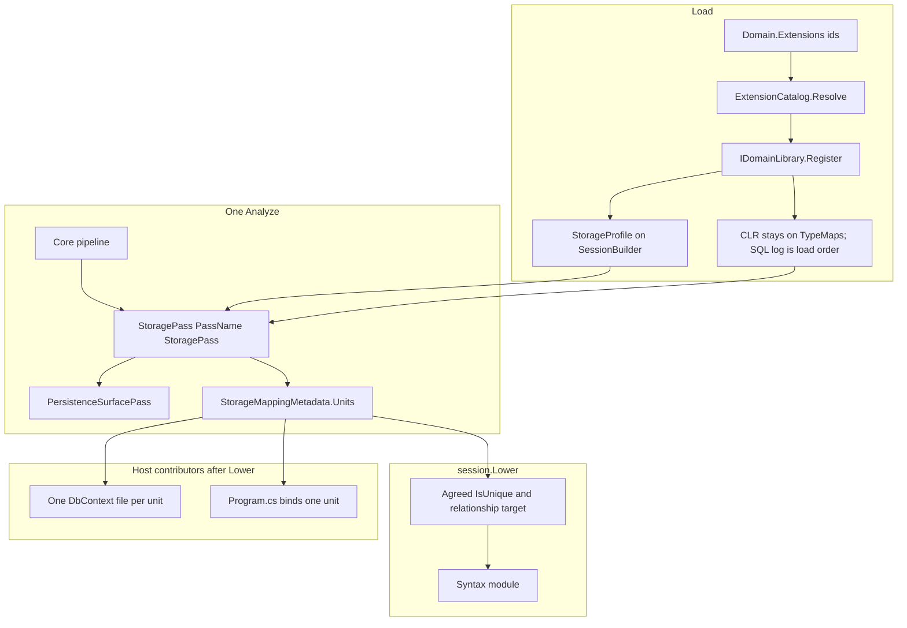
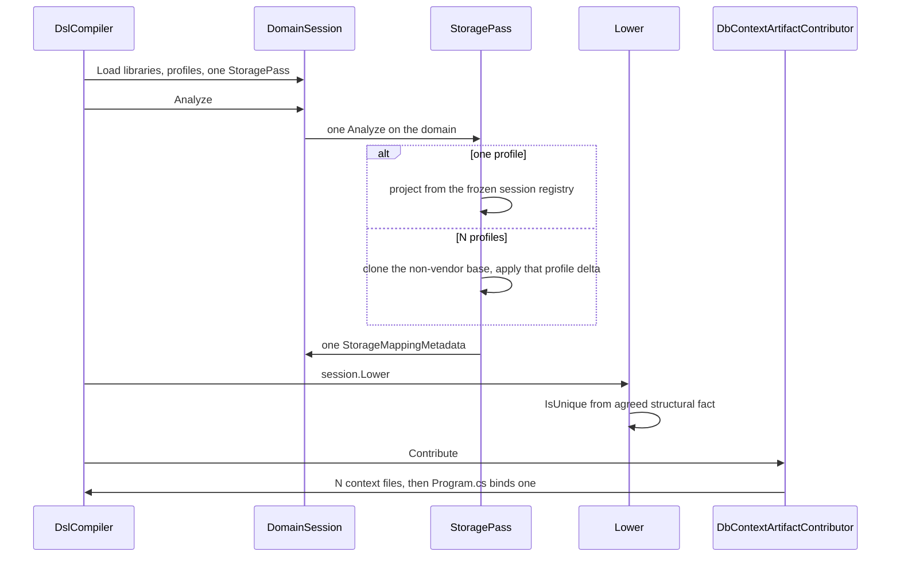

# ADR: Multi-vendor storage layout

**Date:** 2026-10-15
**Status:** Proposed
**Author:** design spike
**Deciders:** product owner (not yet accepted)

**Home:** `docs/decisions/2026-10-15-multi-vendor-storage-layout.md`

`docs/decisions/` records why. `docs/plans/` records execution. This spike chooses a seam and implements nothing. The parent decision already exists, so this file does not open a plan and does not admit work to [`docs/plans/poly-eng/board.md`](../plans/poly-eng/board.md). Follow-ups below stay evidence until a human adds them to the board. An agent does not start them from this document.

**Parent:** [`2026-07-22-persistence-units-medium-facets-pack-syntax-export.md`](2026-07-22-persistence-units-medium-facets-pack-syntax-export.md). This spike is ladder step 4 (a `PersistenceUnit` compile model: two units, two `StorageModel`s, no map merge, context type names that include the pack when more than one unit exists). It does not take ladder steps 2–3 (qualified facets) or 8–10 (Syntax-ify `DbContextGenerator`, extract a C# pack).

**Also binds:** [`docs/CORE.md`](../CORE.md) §0, [`2026-09-04-frozen-core-pipeline.md`](2026-09-04-frozen-core-pipeline.md), [`2026-09-03-facts-concerns-bags-store-bind.md`](2026-09-03-facts-concerns-bags-store-bind.md), [`2026-08-14-domain-libraries.md`](2026-08-14-domain-libraries.md).

Evidence is this worktree (`origin/master`, `e38edcba`). Line numbers were rechecked after master advanced past the review checkout `ddc90e52`. Files that moved are `StorageAnalyzer.cs`, `MinimalApiGenerator.cs`, `DomainTools.cs`, `poly-dsl-guide.md`, `SqlServerPackTests.cs`, and `SqlitePackTests.cs`.

---

## Overview

A Poly domain can name one persistence library. `SqliteLibrary`, `SqlServerLibrary`, `MySqlLibrary`, and `PersistenceEmitLibrary` each call `SessionBuilder.AddAnalyzer` for `StoragePass` (`PassName` `"StoragePass"`) and `PersistenceSurfacePass` (`PassName` `"PersistenceSurface"`). The second library throws at load. Vendor SQL overrides and the SQL Server identifier convention share one `TypeMappingRegistry` and one convention list. `StoragePass` publishes one `StorageMappingMetadata` on the domain node, and `NodeMetadataStore.Set` replaces a second instance of that CLR type.

The three product cases (an entity aimed at one DBMS, the same entity stored in two and switchable in the host, SQLite for a demo and another DBMS for production) are one compile shape: one `DomainSession`, one `Analyze`, N persistence units. Each unit is a profile contributed by a loaded library. One `StoragePass` projects N `StorageModel`s into the one metadata record, keyed by the library id. Host emit writes one `DbContext` file per unit. A single loaded unit keeps today's file name, type name, and bytes.

---

## Background and motivation

### What the parent already locked

The parent ADR's compile model is one domain analysis, then a storage projection per persistence unit on that same `AnalysisResult`. Units do not merge type maps. `--dbms` / `DbmsPack` is sugar for one unit. Unscoped `column` / `table` are the single-store form; qualified facets come before many packs depend on unscoped-only resolution. Artifact path collisions fail closed. The operation module stays provider-agnostic.

That projection is not in the code. What shipped is one authoring registry, one pass, one model, one `{Domain}DbContext`.

### What the code does

| Fact | Where |
|------|--------|
| Library id dedup already exists. A second `sqlite` throws `A library with id 'sqlite' is already loaded.` | `SessionBuilder.Load`, `Poly/DomainModeling/Compile/SessionBuilder.cs:33-38` |
| Pass-name dedup is a different key. `AddAnalyzer` throws `An analyzer with pass name 'StoragePass' is already registered.` The same text exists on `AnalyzerBuilder`. Libraries hit `SessionBuilder` first. This spike did not execute the throw. | `SessionBuilder.cs:63-69`; `Poly/Analysis/AnalyzerBuilder.cs:16-22` |
| Each vendor pack registers both passes and writes SQL onto the shared registry. SQL Server also appends `SqlServerIdentifierConvention` to the one list. | `src/Poly.Packs.Sqlite/SqlitePack.cs:20-24`, `src/Poly.Packs.SqlServer/SqlServerPack.cs:17-22`, `src/Poly.Packs.MySql/MySqlPack.cs:17-21`, `Poly/DomainModeling/Libraries/Storage/PersistenceEmitLibrary.cs:21-24` |
| `TypeMappingRegistry` is one pair of dictionaries. `OverrideSqlColumnType` / `OverrideClrTypeName` replace by key. `Clone` copies both. | `Poly/DomainModeling/Meaning/TypeMappingRegistry.cs:12-13`, `47-60` |
| None of the three Defaults types call `OverrideClrTypeName`. They only override SQL. Temporal writes both CLR and SQL onto the same session registry. | `SqliteDefaults.cs:20-56`, `SqlServerDefaults.cs:18-43`, `MySqlDefaults.cs:14-42`, `TemporalTypeMaps.cs:8-25`, `TemporalLibrary.cs:25` |
| `DomainSession` holds one `TypeMaps` and one `StorageConventions`. `WithDomain` copies those references when `uses` is unchanged. | `DomainSession.cs:29-31`, `172-176` |
| `StoragePass.PassName` is the constant `"StoragePass"`. It constructs one `StorageAnalyzer` and `SetMetadata`s one `StorageMappingMetadata`. | `StoragePass.cs:19-20`, `64-66` |
| The metadata record is `(StorageModel Storage)`. | `StorageMappingMetadata.cs:7` |
| The store keys `(NodeId, CLR type)` and overwrites the same type. | `NodeMetadataStore.cs:10`, `38-40`, `102-113`; `AnalysisContext.cs:95`, `110` |
| `column("NAME","TYPE")` and `table("NAME")` are unscoped. The walker resets on every match, so the last annotation wins. An explicit TYPE sets that column's `ColumnType` only (`columnType = colType ?? baseColumnType`). It does not call `OverrideSqlColumnType`. | `StorageAnalyzer.cs:98-140`, `142-157`, `284-285` |
| The host treats the vendor as one slot: `LinkedVendor` + `SwapPersistence` replace `persistence` with `sqlite` or `sqlserver`. | `DslCompiler.cs:206-236`, `270-274` |
| `CompileCore` seeds a file-name set from `Emit`'s files and `continue`s when a later catalog file leaf is already in that set. | `DslCompiler.cs:184-191` |
| Two `ResolveDbms` methods disagree. The compiler walks extra libraries and keeps the last `sqlite` or `sqlserver`. The host contributor walks `domain.Extensions` and returns the first. `mysql` changes neither result. | `DslCompiler.cs:307-319`; `MinimalApiGenerator.cs:1234-1241` |

`PersistenceEmitLibrary` documents the current rule in one sentence: vendor libraries register the same overlay; do not load both (`PersistenceEmitLibrary.cs:8`).

### Who reads the one model

`StorageModel` is load-bearing past codegen. Readers split into structural facts and host SQL.

| Reader | What it uses | Vendor SQL? |
|--------|----------------|-------------|
| `EffectLoweringPass.IsUniqueProperty` | Column `IsUnique` for the current entity. Falls back to `UniqueConstraint` only when the bag itself is absent. A present bag and a missing entity returns false (`:278-279`). Slice 2 uses that fact fallback only when the agreement helper returns null. | No. `EffectLoweringPass.cs:272-285` |
| `DomainInstanceStore.CreateIn` | `StorageRelationship` name, source entity, `TargetType`. Falls back to relationship facts when that pair is absent (`:112-114`). After this layout it calls the agreement helper and still uses that fallback when the helper returns null. | No. `DomainInstanceStore.cs:104-115` |
| `DbContextGenerator` | Keys, columns, navs, FKs, `ColumnType` via `HasColumnType`, `IsUnique` indexes. Type name is hardcoded `$"{domain.Name}DbContext"`. | Yes, `ColumnType` only. `DbContextGenerator.cs:31-38`, `223-227` |
| `MinimalApiGenerator` / `MinimalApiHostArtifactContributor` | `IsRoot`, `KeyClrType`, verified ranges. Provider call is `DbmsPack`, separate from the model. Context type name is hardcoded `$"{domain.Name}DbContext"`. | No column SQL. `MinimalApiGenerator.cs:109-120`, `:329`, `:380`, `:824-828`, `:1216` |
| `HttpFileGenerator` | `IsRoot` for route shape. | No. |
| `DomainTools` | Presence of the metadata record. | No. `DomainTools.cs:324` |
| `RuntimeAnalysisCache.ClrTypeName` | Session `TypeMaps.ToClrTypeName`. Entity C# uses this, not pack SQL. | No. `RuntimeAnalysisCache.cs:56-59` |

`IsUnique` is assigned from `UniqueConstraint` (`StorageAnalyzer.cs:297`). `IsRoot`, key name, and key CLR in the pipeline come from `EntityStructureMetadata` (`StorageAnalyzer.cs:177-190`), not from the vendor registry. Per-entity navigations are copied when the source type matches (`StorageAnalyzer.cs:313-319`). The relationship list on the model is every domain relationship, with no entity filter (`StorageAnalyzer.cs:86`). `StorageRelationship` exposes `Name`, `SourceType`, `TargetType`, `Cardinality`, and `SourceOwnsTarget` (`StorageModel.cs:219-223`). `BuildForeignKeys` adds an FK for every non-root aggregate child (`StorageAnalyzer.cs:385-414`). `SqlServerIdentifierConvention` returns null when the name fits and throws when a table or column exceeds 128 characters (`SqlServerIdentifierConvention.cs:17-35`). It does not rewrite names.

So two units built from the same facets and the same CLR registry agree on uniqueness, roots, keys, and relationship endpoints. They differ in `ColumnType`, and they can differ later in table name and column name once qualified facets exist. The SQL Server convention must see only the SQL Server profile.

### Host pin that slice 1 keeps

`SliceC_CompileDbmsPack_AlwaysWins_ProgramProvider` compiles `HttpHostDomain` (`uses temporal`, `uses storage`, `uses sqlite`, `uses http`) twice under `CompileMode.Entities`. `DbmsPack.Generic` emits `UseInMemoryDatabase` and must not emit `UseSqlite`. `DbmsPack.Sqlite` emits `UseSqlite` and must not emit `UseInMemoryDatabase`. (`SliceCProducerLoopCatalogTests.cs:44-55`, `203-218`.)

`CompileMode.Entities` makes `LinkedVendor` return null (`DslCompiler.cs:206-208`), so the source `uses sqlite` stays loaded and the SQLite profile still builds the `DbContext`. The enum selects only the provider call inside `MinimalApiHostArtifactContributor`, which is constructed with that enum (`DslCompiler.cs:289`, `MinimalApiGenerator.cs:1180-1213`). The test pins a real split: provider string and column types are allowed to disagree when the compile enum says Generic and the domain loaded sqlite. This spike keeps that split for one unit.

### MySQL is a library id and not a product catalog entry

`IDomainLibrary.Id` for the four persistence libraries: `persistence`, `sqlite`, `sqlserver`, `mysql`.

`ExtensionCatalog.Core` is temporal, storage facets, and `PersistenceEmitLibrary` (`ExtensionCatalog.cs:29-32`). `ProductCatalog.Catalog` adds sqlite, sqlserver, and http (`ProductCatalog.cs:11-15`). `Poly.DslCompiler` references `Poly.Packs.Product` only (`Poly.DslCompiler.csproj:12-13`). Product references `Poly.csproj`, sqlite, and sqlserver (`Poly.Packs.Product.csproj:12-14`). That item group has no MySQL reference.

`OpenCompileSession` special-cases `http`, `persistence`, `sqlite`, and `sqlserver` (`DslCompiler.cs:288-295`). Any other id, including `mysql`, falls through to `catalog.Resolve(id)` (`DslCompiler.cs:296-297`). That resolve throws `Unknown domain extension 'mysql'.` (`ExtensionCatalog.cs:54-58`) because neither catalog contains it. The id is mentioned in one guard: Db/All mode skips adding generic `persistence` when the id list already contains `mysql` (`DslCompiler.cs:275-277`). That guard does not construct `MySqlLibrary`. `ParseDbmsPack` accepts `generic`, `sqlite`, and `sqlserver` (`DslCompiler.cs:323-331`). `DbmsPack` has no mysql value (`DslCompiler.cs:34-41`).

`Poly.Tests` does reference the MySQL project. Pack tests call `new MySqlLibrary()` directly.

### Census of `StorageMappingMetadata`

A `*.cs` search of this worktree finds **35 matching lines in 17 files** (7 product + 10 under `Poly.Tests`). The expected 16-file census is short by one test file. Docs were excluded; a search that includes markdown is larger and is not this census.

Product:

| File | Lines |
|------|-------|
| `Poly/DomainModeling/Analysis/StorageMappingMetadata.cs` | 7 |
| `Poly/DomainModeling/Analysis/StoragePass.cs` | 6, 66 |
| `Poly/DomainModeling/Lowering/EffectLoweringPass.cs` | 274 |
| `Poly/DomainModeling/Runtime/DomainInstanceStore.cs` | 104 |
| `src/Poly.DslCompiler/DbContextArtifactContributor.cs` | 20 |
| `src/Poly.DslCompiler/MinimalApiGenerator.cs` | 1199 |
| `Poly.Mcp/Tools/DomainTools.cs` | 324 |

Tests:

| File | Lines |
|------|-------|
| `Poly.Tests/DomainModeling/Analysis/DomainModelAnalyzerContextTests.cs` | 35, 42, 46, 54, 71, 72, 101 |
| `Poly.Tests/DomainModeling/Analysis/PipelineMergeMetadataTests.cs` | 402, 403 |
| `Poly.Tests/DomainModeling/Compile/EmitSessionContractTests.cs` | 89, 90, 95, 96, 116 |
| `Poly.Tests/DomainModeling/Compile/PipelineTransformationTests.cs` | 205 |
| `Poly.Tests/DomainModeling/Compile/SliceCProducerLoopCatalogTests.cs` | 170, 195 |
| `Poly.Tests/DomainModeling/Lowering/HttpFileGeneratorTests.cs` | 24, 25 |
| `Poly.Tests/DomainModeling/Lowering/InfrastructureAnalyzerTests.cs` | 789, 809 |
| `Poly.Tests/DomainModeling/Lowering/MinimalApiGeneratorTests.cs` | 228 |
| `Poly.Tests/DomainModeling/Lowering/StoreBindUniqueTests.cs` | 86 |
| `Poly.Tests/TestHelpers/GenerationAssertions.cs` | 21, 22, 32, 33 |

Sites that read the `.Storage` property, and therefore break when that property is removed: `DbContextArtifactContributor.cs:20`, `MinimalApiGenerator.cs:1199`, `EffectLoweringPass.cs:274-276`, `DomainInstanceStore.cs:105`, `EmitSessionContractTests.cs:89`, `95`, `116`, `GenerationAssertions.cs:21`, `32`, `MinimalApiGeneratorTests.cs:228`, `HttpFileGeneratorTests.cs:24`, `DomainModelAnalyzerContextTests.cs:57`, `77`, `78`, `111`, `InfrastructureAnalyzerTests.cs:791` (`storage!.Storage.Entities`). `InfrastructureAnalyzerTests.cs:17` is the `TestInfra` record field and does not break. `DomainTools.cs:324` only tests the record for null and stays valid if the type name stays. The 35-line / 17-file census above is unchanged.

---

## Goals and non-goals

### Goals

1. One domain can load `sqlite` and `sqlserver` together. Analyze does not throw on `PassName`.
2. Each loaded persistence library produces its own `StorageModel`. SQLite `Text` is `TEXT` and `Boolean` is `INTEGER`. SQL Server `Text` is `nvarchar(max)` and `Boolean` is `bit`. Maps are not merged.
3. The SQL Server identifier convention runs only against the SQL Server profile.
4. One loaded unit emits `{Domain}DbContext.cs` / `{Domain}DbContext` with the same bytes as today, for a vendor loaded before temporal and for temporal loaded before the vendor.
5. Two or more units emit one context file per unit, distinct artifact ids, both files present even when `Program.cs` binds one of them.
6. `DbmsPack` on the compile call still selects the one provider registration. The Slice C test stays as written.
7. With N units and a Generic pack, `Program.cs` fails closed and names the unit ids.
8. An unscoped `column(name, type)` TYPE sets that column's `ColumnType` when one unit is loaded. When more than one unit is loaded, analyze reports `StoragePass.UnscopedColumnType` and `Lower` fails closed. The bag is still published.
9. Entity membership defaults to every loaded unit, so "stored in both" is the default. Narrow targeting is a later annotation, not a core keyword.

### Non-goals

- Qualified `sqlite column(...)` / `oracle table(...)` (parent ladder steps 2–3).
- A second unit of the same library id (two SQLite files, two SQL Server databases). Library-id dedup stays.
- Schema, catalog, or connection string as a registration key.
- A generated runtime switch (env var, config binder, second `AddDbContext` chosen by the compiler). The host constructs the context it was given; both files are on disk.
- Oracle, a MySQL `DbmsPack` value, and registering `mysql` in `ProductCatalog`.
- Extracting a C# pack, or moving `DbContextGenerator` onto Syntax as the pack API (parent steps 8–10).
- Data migration, subdirectory layout under `Persistence/Sqlite/`, and editing `board.md`.
- A second analyze, a second interpreter, a consumer-specific lowering flag, a host-escape keyword, or N CLR metadata types.

---

## Proposed design

### Seam

Candidate (a), in the parent's words: one `PersistenceUnit` list on the session, one analyze, one `StoragePass` whose `PassName` stays `"StoragePass"`, N profiles, N models in one metadata record.



`SessionBuilder.Build` appends `StoragePass` and `PersistenceSurfacePass` when the profile list is non-empty and that pass name is absent. Packs stop calling `AddAnalyzer` for those two types. They call `AddStorageProfile`. Vendor `Register` does not call `ApplyTypeMaps(builder.TypeMaps)` and does not call `AddStorageConvention`. `ApplyTypeMaps` stays the source of the delta: the profile stores the pairs that method writes today. The pass does not close over `builder.TypeMaps` at `Register` time. At `Analyze` it reads the bound session (`DomainSession.Analyze` already binds before the pipeline, `DomainSession.cs:184-188`).

`Load` records an ordered SQL log around `Register` (`SessionBuilder.cs:39`). A non-vendor library still writes `builder.TypeMaps` during `Register`. `TemporalLibrary.Register` calls `TemporalTypeMaps.Apply` (`TemporalLibrary.cs:25`), which sets `DateTime` SQL to `timestamp` (`TemporalTypeMaps.cs:18`). That library's log entry is the SQL diff of the dictionary before and after its `Register`, at that load position. A vendor library's log entry is the profile's `SqlColumnTypes`, at the position of that `Load`. `Register` itself does not write those pairs onto `builder.TypeMaps`.

The live SQL dictionary is not today's last-wins once vendor `Register` stops writing. A later non-vendor write lands on a dictionary the vendor never touched. `Build` replaces that SQL dictionary with a replay of the log onto core SQL defaults and keeps the CLR dictionary `Register` already wrote. That pair is what `TypeMaps.Clone()` stores on the session (`SessionBuilder.cs:85`). The replay is the session registry. It is not a second application on top of the live SQL dictionary.

One profile. This is every current golden, and any session that loaded a single persistence library.

1. `Build` replays the whole log in load order. The vendor delta sits at that library's position. A later non-vendor override wins on an overlapping key. The frozen `session.TypeMaps` is today's last-`Register`-wins dictionary, including a vendor that loaded before temporal.
2. `StoragePass` projects once from that frozen registry. It does not re-apply the delta.

`uses sqlite` then `uses temporal` leaves `DateTime` as `timestamp` where temporal wrote, and leaves sqlite SQL on keys temporal does not overwrite. `uses temporal` then `uses sqlite` leaves `DateTime` as `TEXT` (`SqliteDefaults.cs:37`). `SqlServerDefaults` sets `DateTime` to `datetime2` (`SqlServerDefaults.cs:31`) and does not override `Date`, `Time`, or `Duration`. `docs/probes/dogfood/crm.poly:2` is `uses temporal` only. `Crm_DslCompilerHostFiles_MatchGolden` compiles that file with `CompileMode.All` and `DbmsPack.Sqlite` (`EmitGoldenTests.cs:55-59`), and `LinkedVendor` appends `sqlite` after the source ids (`DslCompiler.cs:270-274`). That is why `CrmDbContext.cs.golden` has `HasColumnType("TEXT")` on `CloseBy` and `DueOn` (`CrmDbContext.cs.golden:121`, `:132`). `EmitGoldenTests` and `SliceC_CompileDbmsPack_AlwaysWins_ProgramProvider` pin that order and the provider call. Goal 4 also pins the reversed order. A test with `uses sqlite` before `uses temporal` and a `DateTime` column expects `timestamp` on that column.

N profiles.

1. `Build` replays only the non-vendor log entries, in load order. Vendor deltas are skipped. Vendor SQL is absent from the shared `session.TypeMaps`.
2. For each profile, clone that base, apply that profile's delta with `OverrideSqlColumnType`, and run `StorageAnalyzer` on the clone.

A vendor loaded before temporal is not overwritten inside its own unit: the delta is applied after the non-vendor base. Two units do not share a dictionary. The one-profile path is not this loop. Re-applying the delta on a clone of the one-profile registry would make vendor SQL beat temporal when the vendor loaded first, and those bytes would move.

Unit conventions are `profile.Conventions` concatenated with `session.StorageConventions`. `SqlServerIdentifierConvention` is on the sqlserver profile only. `SqlServerLibrary.Register` today appends it with `AddStorageConvention` and then passes the live list into `StoragePass` (`SqlServerPack.cs:20-21`). That call stops, so the convention is not on the shared list and does not see sqlite names. A convention added with `AddStorageConvention` after `Load` still runs on every unit. `SqlServerDefaults_WithPrefixConvention_AppliesBoth` (`SqlServerPackTests.cs:321-334`) is the pin: after `Load(SqlServer)` and `AddStorageConvention(new PrefixConvention("tbl_"))`, the column name is `tbl_name` and the column type is `nvarchar(max)`.

A hand-constructed `new StoragePass()` with an empty profile list keeps today's one-model behavior for tests: project once from the constructor registry, or from `session.TypeMaps` when the constructor registry is null, and store that model under unit id `persistence`. `Build` does not add a second `StoragePass` when the test already registered that pass name.

`persistence` together with any vendor profile fails closed at `Build` (or at `AddStorageProfile` when the set would mix them). Message lists the ids. `SwapPersistence` still rewrites `persistence` to the linked vendor on `CompileMode.Db` and `CompileMode.All` before load (`DslCompiler.cs:146-149`, `270-274`), so a one-pack compile never presents both ids. That sugar stays, because it is what keeps a Generic-or-vendor `Db`/`All` compile on one unit.

### Multiplicity key

The key is the persistence-unit id. It equals `IDomainLibrary.Id`: `sqlite`, `sqlserver`, `mysql`, or `persistence`.

| Question | Answer |
|----------|--------|
| Who assigns it | The library, by returning `Id`. `Register` copies that string onto the profile. |
| Who else can mint one | Nobody. `AddStorageProfile` rejects an id that is not already in `_loadedIdSet`, and rejects a second profile with the same id. `Load` inserts the id into `_loadedIdSet` and then calls `Register` (`SessionBuilder.cs:37-39`). `_loadedIds.Add` runs after `Register` returns (`SessionBuilder.cs:40`). The check uses the set. A check against `_loadedIds` would reject the library's own id, because every pack calls `AddStorageProfile` from `Register`. |
| Relation to `uses` | The domain stores the id. `OpenCompileSession` / `DomainSession.ForExtensions` resolve it through the catalog. Duplicate `uses` already throws (`Domain lists extension '…' more than once.`, `DslCompiler.cs:286-287`, `DomainSession.cs:123-124`). |
| Relation to the extension catalog | The catalog maps id to library instance. Unknown id throws. The profile is not a second catalog. |
| Schema | A later facet on a unit (parent attachment table: entity schema / tablespace). It is not part of the key. Two schemas under one vendor are two units of one pack, and this spike does not build that. |

"Dedup on vendor/schema" is the wrong key, for a specific reason. Library-id dedup already works and does not stop the `PassName` collision, because `sqlite` and `sqlserver` are different ids and still both register `"StoragePass"`. A schema string would dedup something the three product cases do not vary: demo versus production is two library ids, and per-entity targeting is membership on those ids. Putting schema in the registration key would make `dbo` and `app` two pipelines before any facet says the table lives in a schema.

The parent's `PersistenceUnit` has both `Name` and `PackId` (`2026-07-22` §3). This spike sets `Name` equal to `PackId`. A later slice can split them if a real domain needs two units of one pack. That split is an explicit unit name supplied by the host, still not a schema string.

### Metadata shape

One record, one `SetMetadata` call, N models inside it. `NodeMetadataStore` cannot hold two instances of `StorageMappingMetadata`. This design does not add `SqliteStorageMappingMetadata` or any other CLR type per vendor.

```csharp
namespace Poly.DomainModeling.Analysis;

public sealed record StorageUnitModel(
    string UnitId,
    string Title,
    StorageModel Model);

public sealed record StorageMappingMetadata(
    IReadOnlyList<StorageUnitModel> Units) : IAnalysisMetadata {
    public StorageUnitModel Require(string unitId) { /* ordinal lookup; throw listing known ids */ }
    public StorageModel OnlyUnit() { /* Count == 1, else throw listing ids */ }
    public bool? AgreedIsUnique(string entityName, string propertyName) { /* below */ }
    public string? AgreedRelationshipTarget(string relationshipName, string sourceEntity) { /* below */ }
}
```

There is no long-term `Storage` property and no primary-vendor slot. `OnlyUnit()` exists so a caller that is defined for one unit fails closed when the list is longer, instead of reading index 0. Host emitters that run for N units call `Units`, not `OnlyUnit()`. PR 1 analyzes two loaded units successfully. A contributor that still calls `OnlyUnit()` throws, listing the ids, until PR 2 walks `Units`. `OpenCompileSession` still constructs one `DbContextArtifactContributor` per persistence library (`DslCompiler.cs:291-295`) until that PR.

`AgreedIsUnique` compares `IsUnique` on units whose model contains the entity. `AgreedRelationshipTarget` compares relationship name, source, target, and cardinality on units that retained that `StorageRelationship`. Both throw `InvalidOperationException` naming the entity, the property or relationship, and the unit ids when those units disagree. The compared set also includes `IsRoot`, `KeyName`, and `KeyClrType`. `ColumnType`, `TableName`, and `ColumnName` stay per unit. The parent allows the same entity to map to different tables per context; folding table name into the agreement check would reject that later facet. The helper returns null when no unit contains the entity or the relationship.

`StoragePass` publishes the bag whenever the models were built. `SetMetadata` runs on that path, including when the pass also reports `StoragePass.StructuralDisagree` or `StoragePass.UnscopedColumnType`. `DomainSession.Lower` and `Emit` call `DomainModelAnalyzer.ThrowIfHasErrors` before any catalog exists (`DomainSession.cs:224`). That throw is the compiler gate.

`EffectLoweringPass.IsUniqueProperty` and `DomainInstanceStore.CreateIn` call the helpers, so a reader that bypasses `Lower` still throws when retained units disagree. Slice 1 keeps today's missing-entity result: a present bag and an entity absent from it returns false, and the `UniqueConstraint` fallback is not used (`EffectLoweringPass.cs:278-279`). The fact fallback for a null helper result is slice 2 only, when membership can omit the entity from every unit. Slice 1 puts every entity in every unit, so a lookup miss stays false.

`PersistenceSurfaceMetadata` stays one empty marker (`PersistenceSurfaceMetadata.cs:5-16`). It means "a persistence library loaded." It does not grow a vendor field. Emit iterates `Units`.

### Per-profile SQL and conventions

```csharp
namespace Poly.DomainModeling.Compile;

public sealed class StorageProfile {
    public StorageProfile(
        string unitId,
        string title,
        IReadOnlyDictionary<string, string> sqlColumnTypes,
        IReadOnlyList<IStorageConvention> conventions) { /* ordinal id, non-empty title, copy the dictionary */ }

    public string UnitId { get; }
    public string Title { get; }
    public IReadOnlyDictionary<string, string> SqlColumnTypes { get; }
    public IReadOnlyList<IStorageConvention> Conventions { get; }
}
```

Titles are pack-supplied, not derived by the host: `Sqlite`, `SqlServer`, `MySql`, `Persistence`. Artifact ids forbid whitespace, `/`, and `#` in a segment (`ArtifactId.cs:54-58`), and these four titles are legal.

`SqliteLibrary.Register` becomes: `AddStorageProfile` with the `SqliteDefaults.ApplyTypeMaps` pairs and an empty convention list. `SqlServerLibrary.Register` adds the same plus `SqlServerIdentifierConvention` on that profile only, and stops calling `AddStorageConvention`. `MySqlLibrary` adds its pairs and no convention. `PersistenceEmitLibrary` adds unit id `persistence`, title `Persistence`, an empty SQL delta, and no conventions. None of them call `ApplyTypeMaps(builder.TypeMaps)` and none of them call `AddAnalyzer`.

`SessionBuilder` keeps `TypeMaps` and `StorageConventions`. Non-vendor libraries still write the session registry during `Register`. Session conventions are concatenated onto every unit, as the seam section says. Product entity emit reads CLR through `RuntimeAnalysisCache.ClrTypeName`, and the three Defaults types do not override CLR, so entity goldens stay. One profile still materializes vendor SQL onto `session.TypeMaps`, so the DbContext golden stays and the session-registry asserts below stay.

Tests that project through `new StorageAnalyzer(domain, typeMaps: session.TypeMaps, conventions: session.StorageConventions)` after `Load(vendor)` read `Units`. The session convention list no longer contains `SqlServerIdentifierConvention`, so that constructor misses the profile convention. The files are `Poly.Tests/DomainModeling/Lowering/SqlServerPackTests.cs` and `Poly.Tests/DomainModeling/Lowering/SqlitePackTests.cs`. `SqlServerPackTests.AnalyzeStorage` (`:29-33`) is the helper those SqlServer tests use, including `AddPack_SqlServer_AppliesTypeMaps` (`:51-56`), `AddPack_SqlServer_AppliesIdentifierConvention` (`:80-102`), `OversizedTableName_FailsClosed` (`:293-314`), and `SqlServerDefaults_WithPrefixConvention_AppliesBoth` (`:321-334`). Sqlite projections at `SqlitePackTests.cs:54`, `:73`, `:89`, and `:115` read `Units`, including `SameDomain_GenericVsSqlite_DifferentDefaults` (`CreatedAt` is `TEXT` against temporal `timestamp` at `:102-103`) and `ExplicitColumnType_StableUnderSqlitePack` (`:107-118`).

Direct `ApplyTypeMaps` registry tests stay on a fresh registry: `SqlServerDefaults_GuidMapsToUniqueidentifier` and `SqlServerDefaults_Int32MapsToInt` (`SqlServerPackTests.cs:156-165`). These session-registry pins stay, because one profile replays the vendor delta onto `session.TypeMaps`: `SqlitePackTests.AddPack_Sqlite_OverridesNumberColumnType` (`:41-43`), `MySqlPackTests.AddPack_MySql_AppliesTypeMaps` (`:11-28`), `DslCompilerSqliteOracleTests.ForExtensions_Sqlite_RegistersTypeMaps` (`:124-129`), and `PipelineTransformationTests.Analyze_WithSqlite_GetOrAnalyzeSeesSqliteMaps` (`:203-204`). `DomainPackTests.Load_RegistersAnnotationsAndTypeMaps` (`Poly.Tests/DomainModeling/Packs/DomainPackTests.cs:34-45`) writes `builder.TypeMaps` from a test library and stays on the session registry. It is not a vendor profile.

### Entity membership

Default: every entity is in every loaded unit. Case 2 (stored in both) and case 3 (demo and production from one model) fall out of loading two libraries. `Program.cs` is the switch, and it is a file that names one context type.

Slice 1 has no new syntax. Unscoped `column("name")` and `table("name")` apply to every unit. Unscoped `column("name", "TYPE")` is a single-medium declaration:

- One loaded unit: the annotation sets that column's `ColumnType` only, as `StorageAnalyzer.cs:285` does today (`columnType = colType ?? baseColumnType`). The cloned registry is unchanged. Other columns of the same domain type keep the registry string. `ExplicitColumnType_StableUnderSqlitePack` expects `VARCHAR2(20)` on that column and `CODE` as the name (`SqlitePackTests.cs:107-118`).
- More than one loaded unit: `StoragePass` reports `StoragePass.UnscopedColumnType` on the property and still publishes the bag. The message names the property and the unit ids. That column's `ColumnType` is the annotated string on each unit. `Lower` throws at `DomainSession.cs:224`. Standalone `StorageAnalyzer` use with a null context throws `InvalidOperationException` with the same message, matching the existing empty-argument throws (`StorageAnalyzer.cs:116-123`).

Slice 2 adds a library annotation `store("unitId")`, registered like `column` / `table`. It is not a core keyword and not a new `DslTokenKind`. The scanner already returns `Identifier` for pack words (`DslTokenKind.cs:6-8`). The grammar rule `"annotation"` is `Identifier ( annotation-args )` (`DslGrammar.cs:198-210`). The parser accepts a registered keyword in the entity header and the property tail (`PolyDslParser.cs:180-188`, `399-437`) and rejects an unregistered one. `AnnotationRegistry.Register` is the keyword gate (`AnnotationRegistry.cs:27-34`). `DomainDslPrinter.PrintFacet` prints whatever the registered handler returns (`DomainDslPrinter.cs:436-438`). `IAnnotationSyntax` is the print contract (`IAnnotationSyntax.cs:11-19`).

So slice 2 does not change the tokenizer, `DslTokenKind`, `DslGrammar`, or `PolyDslParser`. It changes:

| File | Change |
|------|--------|
| `Poly/DomainModeling/Meaning/SqlAnnotationSyntax.cs` | Add `StoreAnnotationSyntax` (`Keyword` `"store"`, one string argument). Same file as `ColumnAnnotationSyntax` / `TableAnnotationSyntax`. |
| `Poly/DomainModeling/Libraries/Storage/StorageFacetLibrary.cs` | `Register` the handler next to column and table (`StorageFacetLibrary.cs:10-13`). `EnsureRegistered` already runs for compiler and authoring sessions. |
| `Poly/DomainModeling/Analysis/StorageAnalyzer.cs` | Read entity-header `store` facets. Membership is the set of arguments, not last-wins. Zero `store` annotations means every loaded unit. An unknown id fails closed. A `store` on a property fails closed. |
| `Poly.Mcp/Docs/poly-dsl-guide.md` | Document `store` beside `column` / `table` (`poly-dsl-guide.md:324-340` and the projection section near `1060`). AGENTS requires the guide to move in the same change as a DSL surface. This surface is a registered annotation, and the guide is the author-facing contract. |

Repeatable `store("sqlite") store("sqlserver")` means the entity is in that set. Duplicate arguments collapse. An entity omitted from a unit is absent from that unit's `StorageModel.Entities`. The unit also omits the navigation, the foreign key, and the `StorageRelationship` when either endpoint entity is absent. Case 1 is some entities in one DBMS and some in another. Real domains have relationships, so membership is not the connected component: annotating one entity does not require annotating every entity it reaches. The parent rules at `2026-07-22` lines 197-198 are the same domain analysis and no merged type maps. Frozen core is one analyze and one lower (`docs/CORE.md:14-22`). Neither requires a closure.

| List | Where | Filter |
|------|--------|--------|
| `rels`, assigned to `StorageModel.Relationships` | `StorageAnalyzer.cs:86`. Built from `_relationships` at `:74-76`, then `Select(r => new StorageRelationship(r))` with no entity filter today. | Omit the `StorageRelationship` when the source entity or the target entity is absent from the unit. Fields: `Name`, `SourceType`, `TargetType`, `Cardinality`, `SourceOwnsTarget` (`StorageModel.cs:219-223`). |
| Per-entity navigations | `StorageAnalyzer.cs:313-319`. Today the loop continues unless `rel.Source.TypeName` equals the entity. | Also require the target entity to be in the unit. There is no second inverse loop. |
| Foreign keys | `BuildForeignKeys`, `StorageAnalyzer.cs:385-414`. A non-root aggregate child always receives an FK whose parent is `agg.AggregateParentName` (`:407-413`). | Omit that FK when the parent entity is absent from the unit. |

`DanglingRelationship` is not an analyze error. The domain relationship stays on the entity. `CreateIn` calls `AgreedRelationshipTarget`. Units that omitted the pair are not a disagreement. When no unit retained a matching `StorageRelationship`, the helper returns null and `CreateIn` uses the domain relationship fact (`DomainInstanceStore.cs:112-114`). A retained copy's `TargetType` is that same fact (`StorageModel.cs:221`). Disagreement among retained copies throws.

The slice 2 test loads both units, leaves the parent in both, and puts `store("sqlite")` on the child. The sqlite unit keeps the navigation, the FK, and the `StorageRelationship`. The sqlserver unit has none of the three. `CreateIn` for that relationship still lowers the child from the domain fact.

Slice 2 generators iterate the unit's `StorageModel.Entities`. Today's `DbContextGenerator` iterates `domain.Types` and indexes the model by name (`DbContextGenerator.cs:34-42`); a missing entity throws `KeyNotFoundException`. That iteration change is slice 2, because slice 1 puts every entity in every unit and the lookup hits.

### Emission and Program.cs

`DbContextArtifactContributor` is registered once by the host when the profile list is non-empty. The only product construction that passes the contributor into a library is `OpenCompileSession` (`DslCompiler.cs:291-295`). Those three arms stop passing it. `ProductCatalog` already constructs `new SqliteLibrary()` / `new SqlServerLibrary()` with a null contributor (`ProductCatalog.cs:13-14`). After the load loop the compiler calls `AddArtifactContributor(new DbContextArtifactContributor())` once. One contributor walks `Units` and returns one tree and one file per unit.

Context type and file name:

| Units loaded | Type | File |
|--------------|------|------|
| 1 | `{Domain}DbContext` | `{Domain}DbContext.cs` |
| 2 or more | `{Domain}{Title}DbContext` | `{Domain}{Title}DbContext.cs` |

`Catalog` + sqlite only stays `CatalogDbContext`. `Crm` + sqlite only stays `CrmDbContext`. `Hotel` + sqlite + sqlserver becomes `HotelSqliteDbContext` and `HotelSqlServerDbContext`. The title is the profile's `Title`, so the host does not Pascal-case the id.

Artifact identity is `ArtifactId.Create([domain.Name, fileName], type)` (`ContributedFile.cs:31-46`, `GeneratedTree.cs:71-74`). Two titles produce two ids, for example `Hotel/HotelSqliteDbContext.cs#file` and `Hotel/HotelSqlServerDbContext.cs#tree`. `ArtifactCatalog.Register` throws `Artifact '{id}' is already registered.` on a repeated id (`ArtifactCatalog.cs:52-53`). That is the path-collision failure. A single-unit compile still registers one `{Domain}DbContext.cs` and the golden stays.

`CompileCore`'s seen-set (`DslCompiler.cs:184-191`) is not the collision mechanism. It starts from the file names `Emit` already returned and skips a catalog file with the same leaf so those files are not appended twice. Equal contributor paths never reach it: the second `Register` throws first, because the id's last segment is the file name and the first segment is the domain name. Replacing the seen-set with a hard failure would reject every Emit file on the catalog walk. Leave the seen-set. Distinct unit file names do not hit it. A layout that used different id paths and the same leaf is refused by the contributor, which checks the leaf set before `Register` and throws `InvalidOperationException` naming both paths. Flat names only: a segment cannot contain `/` (`ArtifactId.cs:54-58`), and `ContributedFile.FileName` returns the last segment (`ContributedFile.cs:49-58`). The parent's `Persistence/Sqlite/…` directories wait until the writer grows a relative path. This spike does not grow it.

`DbContextGenerator` gains a context-type argument. The default stays `$"{domain.Name}DbContext"` so existing callers and the one-unit path keep the current type inside the file (`DbContextGenerator.cs:36`). The contributor passes the titled name when `Units.Count > 1`.

`Program.cs` binding, one function used by both `DslCompiler.ResolveDbms` and `MinimalApiHostArtifactContributor.ResolveDbms`:

| Loaded persistence units | Compile `DbmsPack` | Result |
|--------------------------|--------------------|--------|
| 1, any id | `Generic` | `UseInMemoryDatabase`, context type `{Domain}DbContext`. This is Slice C. |
| 1 `sqlite` | `Sqlite` | `UseSqlite`, `{Domain}DbContext` |
| 1 `sqlserver` | `SqlServer` | `UseSqlServer`, `{Domain}DbContext` |
| N, and `sqlite` is one of them | `Sqlite` | `UseSqlite`, context `{Domain}SqliteDbContext`. Every unit file is still emitted. |
| N, and `sqlserver` is one of them | `SqlServer` | `UseSqlServer`, context `{Domain}SqlServerDbContext`. Every unit file is still emitted. |
| N | `Generic` | Throw. Message lists unit ids. No first-match and no last-match. |
| The named pack's id is not loaded | `Sqlite` or `SqlServer` | Throw. Message lists unit ids. |

`Compile(poly, mode, params IDomainLibrary[])` today derives `DbmsPack` by last match (`DslCompiler.cs:307-319`). When that array contains both `sqlite` and `sqlserver`, the overload throws listing the ids instead of calling `CompileCore` with a guessed pack. The caller uses the `DbmsPack` overload to name the provider. One known vendor in the array still maps to that enum value. `mysql` in the array does not set the enum.

The null-override harness path (`new MinimalApiHostArtifactContributor()` with no `dbms`, `MinimalApiGenerator.cs:1180-1188`) uses the same table against `domain.Extensions`. First-wins is removed. One `sqlite` or one `sqlserver` binds that unit. Two of them throw. A lone `mysql` or a lone `persistence` on that path: `persistence` binds `UseInMemoryDatabase` (today's generic profile); `mysql` throws `unit 'mysql' has no Program.cs provider` until a host arm exists. An explicit `DbmsPack.Generic` on the compiler path still wins for one unit, including a mysql unit, and emits `UseInMemoryDatabase`. That is the Slice C rule applied to whatever single unit loaded.

Both context files are written on the success path before `Program.cs` is written, by the one contributor. The switch the owner asked for is the produced host constructing `HotelSqliteDbContext` or `HotelSqlServerDbContext`. It is the same process, the same Syntax module, and a different generated type. Slice 1 does not emit a second `AddDbContext` or a config switch.

`DbContextGenerator` keeps iterating domain entities in slice 1. Slice 2 switches it, `MinimalApiGenerator`, and `HttpFileGenerator` to the active unit's entity list so a targeted-away entity is absent from that context and from the routes bound to it.

### What stays frozen

| Frozen rule (`docs/CORE.md` §0, `2026-09-04`) | How this layout sits on it |
|-----------------------------------------------|----------------------------|
| Nodes are the symbolic primary. No product-path primitive IR. | `StorageModel` stays an analysis bag. The operation module is still `session.Lower`. |
| Analysis owns facts and rewrite. Bags on nodes. Semantic consume needs `AnalysisResult`. | N models are one bag on the domain node. `SetMetadata` is called once. |
| Libraries extend the session. `uses` ids. Unknown and duplicate ids fail closed. | The unit id is the library id. Duplicate id still throws at `Load`. |
| One analyze, then `session.Lower`, then the artifact set. | Profiles are inputs to the one `StoragePass`. The parent said re-run the storage projection per unit on the same `AnalysisResult`. That loop is inside the pass. |
| Syntax module is privileged for meaning and the Interpreter sim. Other artifacts are delivery. | DbContext files are host artifacts. They call the module. They do not define operations. |
| The operation tree has no bag types and no vendor types (`2026-09-03`). | Lowering reads `IsUnique` and relationship targets through the agreement helper and emits the same `EnsureUnique` / `CreateIn` invokes. `ColumnType` stays in the host file. |
| No consumer-specific lowering flag. No second interpreter. No `Main` in core. | `Program.cs` remains an opt-in `uses http` artifact. Vendor choice in that file is a provider invocation, not a lowering flag. |
| Shipped ⊆ lowerable. No host-escape keyword. | `store` is a library annotation, and only in slice 2. Slice 1 adds no syntax. |
| Doors map the catalog. | `DbmsPack` stays CLI sugar for the single provider. A mysql unit can exist in the bag without an enum value. |



### Risks

| Severity | Risk | Mitigation |
|----------|------|------------|
| High | A reader keeps `.Storage` and silently uses one model while two were projected. | Delete the property. `OnlyUnit()` throws when `Count != 1`. The census list is the edit list. |
| High | Tests that construct `StorageAnalyzer(session.TypeMaps, session.StorageConventions)` go red once vendor `Register` stops `AddStorageConvention`, even when one-profile `session.TypeMaps` still holds the vendor string. | Those tests read `Units` (`SqlServerPackTests.cs`, `SqlitePackTests.cs`). Direct `ApplyTypeMaps` tests and the session-registry pins stay. One profile materializes vendor SQL in load order. N profiles leave vendor SQL off the shared registry. |
| Medium | `AgreedIsUnique` includes `TableName` or `ColumnType` and blocks legal per-unit facets later. | The compared set is listed above. A test with two units and one `unique` property locks the lowering behavior. |
| Medium | A library keeps `AddArtifactContributor(DbContext…)` and the host adds another. The second `Register` throws on `{Domain}DbContext.cs`. | Compiler arms stop passing the contributor in the same change. A test loads sqlite and sqlserver and expects two files and one producer name. |
| Medium | `DbContextGenerator` looks up every domain entity. Slice 2 omission throws `KeyNotFoundException` inside emit. | Slice 2 changes the iteration. Slice 1 does not omit entities. |
| Low | `SqlServerIdentifierConvention` still throws `InvalidOperationException` rather than a diagnostic, so a too-long name aborts the pass with an exception instead of `StoragePass.*` codes. | Leave the convention's contract. The per-profile test shows the sqlite profile does not throw on the same name. |
| Low | Mixing `persistence` with `sqlite` currently throws on `PassName` and will throw on the new mix check instead. | Message names both ids. `SwapPersistence` still prevents the mix on the Db/All sugar path. |

---

## API and interface changes

Future work. No code in this spike.

`SessionBuilder` (`Poly.DomainModeling.Compile`):

```csharp
public SessionBuilder AddStorageProfile(StorageProfile profile);
public IReadOnlyList<StorageProfile> StorageProfiles { get; }
```

`AddStorageProfile` throws `InvalidOperationException` when `profile.UnitId` is already present (`A storage profile with id '{id}' is already registered.`) or when `persistence` would share the list with another unit id (`Persistence unit 'persistence' cannot load with '{other}'.`). The loaded-library check reads `_loadedIdSet` (`SessionBuilder.cs:37`), the set updated before `Register`. It does not read `_loadedIds` (`SessionBuilder.cs:40`).

`DomainSession` gains `IReadOnlyList<StorageProfile> StorageProfiles`. The internal constructor and `WithDomain` (`DomainSession.cs:175`) copy the list. `TypeMaps` and `StorageConventions` stay. One profile's `TypeMaps` is the replayed log. N profiles' `TypeMaps` is the non-vendor replay.

`StoragePass` keeps `public const string Id = "StoragePass"` and `PassName => Id`. The constructor used by `Build` takes no registry. The existing constructor remains for standalone tests.

`StorageMappingMetadata` shape is the record in the metadata section. `PersistenceSurfacePass` is unchanged.

`DbContextArtifactContributor.Contribute` reads `Units`. `DbContextGenerator` gains:

```csharp
public DbContextGenerator(Domain domain, StorageModel storageModel,
    IStorageSyntaxEmitter? emitter = null, string? contextTypeName = null);
```

Null `contextTypeName` keeps `$"{domain.Name}DbContext"`.

`MinimalApiHostArtifactContributor` resolves the active unit with the table in the emission section and passes that unit's `StorageModel` and context type name into `MinimalApiGenerator` and `HttpFileGenerator`. `BuildProviderRegistration` stays a switch on `DbmsPack` (`MinimalApiGenerator.cs:109-120`). No `UseMySql` arm in slice 1.

Slice 2 only, `StorageFacetLibrary` and `StoreAnnotationSyntax`:

```csharp
internal sealed class StoreAnnotationSyntax : IAnnotationSyntax {
    public string Keyword => "store";
    public bool TryPrint(Facet facet, out string text) { /* store("unitId") */ }
}
```

---

## Data model changes

Analysis bag on the domain node:

```text
StorageMappingMetadata
  Units: ordered list
    UnitId: "sqlite" | "sqlserver" | "mysql" | "persistence"
    Title:  "Sqlite" | "SqlServer" | "MySql" | "Persistence"
    Model:  StorageModel   // existing type, unchanged
```

`StorageModel`, `StorageEntity`, `StorageColumn`, `StorageRelationship` stay. A single-vendor session has a one-element list. Column SQL types differ per element. Structural fields agree, or analyze reports `StoragePass.StructuralDisagree` and still publishes the bag. Slice 2 may omit a `StorageRelationship` from one element when either endpoint entity is absent from that unit.

Session-side, not a bag:

```text
DomainSession.StorageProfiles
  unit id, title, SQL delta dictionary, convention list
```

The domain record gains no vendor field. Membership in slice 2 is entity facets named `store`, which the domain already stores as `Annotation` values. No new facet CLR type.

Artifact catalog, per unit:

```text
{Domain}/{FileName}#tree
{Domain}/{FileName}#file    references the tree
```

File name is `{Domain}DbContext.cs` or `{Domain}{Title}DbContext.cs` as in the emission table.

---

## Alternatives considered

| | (a) Profiles, one pass, one bag | (b) One pass per vendor, qualified `PassName` | (c) Per-vendor sub-sessions, composed at the host | (d) Full pipeline once per vendor, merge artifacts |
|--|----------------------------------|-----------------------------------------------|----------------------------------------------------|-----------------------------------------------------|
| What it makes easy | One analyze, one Syntax module, N models, library id as the key. | Reuses `AddAnalyzer` as the registration hook. | Each vendor keeps today's "one registry, one model" code. | Emit could stay single-unit and a script could merge file lists. |
| What it blocks | Two units of one pack, until `Name` splits from `PackId`. | A second identity beside `IDomainLibrary.Id`. Libraries splicing the analyzer list, which `SessionBuilder.AddAnalyzer` documents as flags after the core list (`SessionBuilder.cs:58-61`). | One catalog and one topology. Sub-sessions each bind `RuntimeAnalysisCache` and each lower a module. | The parent's "same `AnalysisResult`, re-run the projection" sentence. |
| Per-entity targeting | Slice 2 filter inside the one projection. | Each pass would filter, and the passes would still need a shared membership rule. | Each sub-session would need the full domain and a private filter, then a merge of facts the operation module is allowed to see. | Targeting becomes "which pipeline included the entity," after two analyzes. |
| Runtime switching | Two host files, one module, host constructs one context. | Same files, extra pass identity to keep unique. | Two modules unless the host throws one away. The bags ADR says one operation tree. | Two analyzes, then a merge step that has to pick structural facts. |
| Verdict | Use this. | Reject. `PassName` fail-closed is the bug, not the key. | Reject. Splits the Syntax module and duplicates catalog and topology. | Reject. A second full pipeline is a second analyze. |

(a) is the parent's step 4. The inner loop of `StoragePass` is the "re-run storage projection per unit" sentence (`2026-07-22` §3). (d) moves that re-run outside `Analyze` and produces two `AnalysisResult`s.

A fifth option, unit `Name` distinct from pack id, is the parent's full record. It is the right shape the day a domain needs two SQL Server databases. It is not required for the three cases in this spike, and building it now means a new way to mint ids beside `uses`. Deferred, not rejected as a future key.

---

## Security and privacy

This is a compiler layout. The trust boundary does not move. Domain text still becomes generated C# on disk. An unscoped `column` TYPE is already interpolated into `HasColumnType` as a constant (`DbContextGenerator.cs:223-227`). Slice 1 rejects that TYPE when two units are loaded, which stops one string from being written into both providers. Connection strings in `Program.cs` stay the literals `BuildProviderRegistration` already emits (`MinimalApiGenerator.cs:113-116`). No new secret, credential, or network call.

---

## Observability

The signal is analysis diagnostics and fail-closed exceptions, which `DslCompiler` already surfaces as `CompileResult.Errors`.

| Code or exception | When |
|-------------------|------|
| `StoragePass.UnscopedColumnType` | Unscoped TYPE argument and more than one unit. The bag is still published. `Lower` throws at `DomainSession.cs:224`. |
| `StoragePass.StructuralDisagree` | Retained units disagree on `IsUnique`, relationship endpoints, `IsRoot`, `KeyName`, or `KeyClrType`. The bag is still published. The agreement helper throws for a reader that bypasses `Lower`. |
| `InvalidOperationException` from `AddStorageProfile` / `Load` | Duplicate unit id, or `persistence` mixed with a vendor. |
| `InvalidOperationException` from the Program.cs rule | N units and `DbmsPack.Generic`, or a named pack whose unit is absent. The message lists unit ids. |
| `Artifact '{id}' is already registered.` | Two contributors chose the same file name. |

No new counters, logs, or traces. `PersistenceSurfaceMetadata` stays the boolean MCP already reads indirectly through storage presence.

---

## Rollout

### Slice 1 — profiles, one pass, two files

No new DSL. Delivers cases 2 and 3 at compile and emit: the same entities, two context files, `Program.cs` binds one. Defers per-entity targeting, qualified TYPE, MySQL-as-product, and a generated switch.

In slice 1:

- Profiles and the dictionary bag. `SetMetadata` runs whenever the models were built.
- Packs stop registering the two passes. Vendor `Register` stops writing SQL onto `builder.TypeMaps` and stops calling `AddStorageConvention`. One profile: `Build` replays the log so `session.TypeMaps` is today's last-wins, and the pass does not re-apply the delta. N profiles: the session registry is core defaults plus non-vendor overrides, and each unit applies its own delta on a clone.
- One `StoragePass`, one `PersistenceSurfacePass`, appended by `Build`.
- Two DbContext files when sqlite and sqlserver both load. One file, old name, old bytes, for both `uses` orders, when one unit loads.
- `DbmsPack` still wins the provider string. Slice C stays unchanged as a test.
- N units and `DbmsPack.Generic` fails closed listing ids.
- Unscoped TYPE with one unit sets that column's `ColumnType`. With N units the diagnostic is reported, the bag is still published, and `Lower` fails closed.
- Artifact path collision fails at `Register` (existing) and the contributor also refuses a repeated leaf.
- `persistence` plus a vendor fails closed. `SwapPersistence` unchanged.

### Slice 2 — `store` membership

Delivers case 1. An entity with one or more `store` annotations is omitted from the other units' models, including DbSets and the routes of the `Program.cs` unit that does not contain it. A relationship, navigation, or FK is omitted from a unit when either end is absent. `CreateIn` still lowers from the domain fact. Default remains every loaded unit. Defers qualified column TYPE and qualified table names (parent resolution order: pack-qualified, then portable, then default).

### Out of both slices

Second interpreter. Full pipeline re-run. Oracle. `DbmsPack.MySql`. `ProductCatalog` gaining mysql. Extracting the C# pack. Syntax-ifying `DbContextGenerator`. Data migration. Subdirectory artifact paths. Editing `board.md`. A consumer-specific lowering flag. A core keyword for storage.

---

## Test plan

Runner, from `docs/plans/poly-eng/LOCAL-AGENT.md:78` and `AGENTS.md`: `dotnet run --project Poly.Tests/Poly.Tests.csproj`, not `dotnet test`. One class: `dotnet run --project Poly.Tests/Poly.Tests.csproj -- --treenode-filter '/*/*/<TestClass>/*'`. Printed C# that is allowed to change uses `POLY_UPDATE_GOLDEN=1` on `/*/*/EmitGoldenTests/*` and then a diff. Slice 1 must not need a golden update.

| Test | Expectation |
|------|-------------|
| `SliceCProducerLoopCatalogTests.SliceC_CompileDbmsPack_AlwaysWins_ProgramProvider` | Unchanged. Generic emits `UseInMemoryDatabase` and does not emit `UseSqlite`. `DbmsPack.Sqlite` emits `UseSqlite` and does not emit `UseInMemoryDatabase`. (`SliceCProducerLoopCatalogTests.cs:203-218`.) |
| `EmitGoldenTests` | Byte-identical for the golden load order (temporal in the source, sqlite appended). Class: `Poly.Tests/DomainModeling/Compile/EmitGoldenTests.cs`. `Emit_MatchesGolden` covers the sample domains under `Poly.Tests/DomainModeling/Compile/EmitGolden/` (`warehouse`, `orders`, `clinic`, `mcp-library`, `university`, `crm`, `hotel`, `simulate-create-type`, `simulate-create-in`, `simulate-create-create-in`), each with `catalog.golden` and entity `*.cs.golden`. `Crm_DslCompilerHostFiles_MatchGolden` covers `EmitGolden/crm-dslcompiler/CrmDbContext.cs.golden`, `Program.cs.golden` (`AddDbContext<CrmDbContext>` and `UseSqlite`), and `demo.http.golden`. Those three files are the single-vendor host pin for that order. They are not the reversed-order pin. |
| New. Load sqlite and sqlserver in one session. | `Analyze` does not throw on pass name. The sqlite model's `Text` column is `TEXT` and its `Boolean` column is `INTEGER`. The sqlserver model's `Text` column is `nvarchar(max)` and its `Boolean` column is `bit`. Compile emits two context files. |
| New. `Load` the same library id twice, and `AddStorageProfile` the same unit id twice. | Fail closed. Existing `Load` message: `A library with id '…' is already loaded.` (`SessionBuilder.cs:38`). |
| New. Unscoped `column("CODE","CHAR(3)")`. | One unit: that column's `ColumnType` is `CHAR(3)`. The registry entry for the domain type is unchanged. Two units: diagnostic `StoragePass.UnscopedColumnType`, the bag is published, and that column's `ColumnType` is `CHAR(3)` on each unit. `Lower` throws. |
| New. `uses sqlite` then `uses temporal`, one unit, a `DateTime` column. | Column type is today's last-wins: `timestamp` where temporal wrote (`TemporalTypeMaps.cs:18`). Sqlite SQL remains on keys temporal does not override. The other order, temporal then sqlite, stays `TEXT` (`SqliteDefaults.cs:37`), which is the `CloseBy` / `DueOn` golden (`CrmDbContext.cs.golden:121`, `:132`). |
| New. Identifier length. | A 129-character table name with only the sqlite profile projects a model. The same name with the sqlserver profile throws from `SqlServerIdentifierConvention`. That convention is on the sqlserver profile, so the sqlite unit does not run it. A session `AddStorageConvention` still runs on both. |
| Slice 2. Parent in both units, child `store("sqlite")`. | The sqlite unit keeps the navigation, the FK, and the `StorageRelationship`. The sqlserver unit has none of the three. `CreateIn` still lowers the child from the domain relationship fact. There is no `DanglingRelationship` diagnostic. |
| Lowering. Two units, one `unique` property, models agree. | `IsUniqueProperty` still takes the bag path and the lowered assign still wraps `EnsureUnique`. Home: extend `StoreBindUniqueTests` (`Poly.Tests/DomainModeling/Lowering/StoreBindUniqueTests.cs`). |
| New, beside the two-file test. | `DbmsPack.Generic` with both units fails and the error text contains both ids. `DbmsPack.Sqlite` with both units emits `UseSqlite`, names `SqliteDbContext`, and still contains the SQL Server context file. |
| New. Forced duplicate leaf. | Contributor throw before a second `Register`, message names the file. |

Filter while iterating slice 1: `/*/*/SliceCProducerLoopCatalogTests/*`, `/*/*/EmitGoldenTests/*`, `/*/*/EmitSessionContractTests/*`, `/*/*/StoreBindUniqueTests/*`, plus the new test class. Full suite at the pre-ship gate.

---

## Open questions

1. Two units of one pack (two SQLite files, or demo and prod on SQL Server only). This spike says no, because the key is the library id. Confirm that case 3 is always two library ids.
2. Registering `mysql` in `ProductCatalog` and adding a `UseMySql` provider arm. This spike leaves `uses mysql` unknown to the compiler catalog and leaves the enum at three values. Confirm mysql stays a test library until a host arm is a product decision.
3. `persistence` plus a vendor fails closed, rather than keeping an in-memory unit beside the vendor units. Confirm. `SwapPersistence` still strips `persistence` on the Db/All path either way.
4. "Switchable" in slice 1 means both context types exist and `Program.cs` constructs one. Confirm that a generated switch is out of scope.
5. One-unit file names stay `{Domain}DbContext` so `CrmDbContext.cs.golden` does not move. The parent's illustrative name includes the pack title even for one unit. Confirm the golden wins.
6. Flat file names, because artifact id segments cannot contain `/`. Confirm subdirectory layout stays deferred.
7. Agreement excludes `TableName` and `ColumnName` so a later qualified facet can differ per unit without failing lowering. Confirm that exclusion.

Anything not determined: this spike did not execute the duplicate-`PassName` throw or the test suite. The throw text is cited from `SessionBuilder.cs:67-69`. No product file was modified.

---

## References

- `docs/CORE.md:14-35` frozen pipeline. `docs/CORE.md:49` bags versus the operation tree.
- `docs/decisions/2026-07-22-persistence-units-medium-facets-pack-syntax-export.md` §3, §4.3–4.4, §8, §9, §10, ladder step 4 at the capability list.
- `docs/decisions/2026-09-03-facts-concerns-bags-store-bind.md:19-29`, `:54` (`IsUnique` preferred from the bag).
- `docs/decisions/2026-09-04-frozen-core-pipeline.md:17-31`, `:49-55`.
- `docs/decisions/2026-08-14-domain-libraries.md:17-23` (MySQL is a library the host loads).
- `Poly/DomainModeling/Compile/SessionBuilder.cs:23-24`, `:33-43`, `:46-71`, `:75-91`.
- `Poly/DomainModeling/Compile/DomainSession.cs:29-31`, `:172-188`, `:219-224`.
- `Poly/DomainModeling/Compile/IDomainLibrary.cs:8-13`.
- `Poly/DomainModeling/Compile/ExtensionCatalog.cs:29-32`, `:54-58`.
- `Poly/DomainModeling/Compile/ArtifactId.cs:9-40`, `:54-58`. `ArtifactCatalog.cs:43-54`. `IArtifactContributor.cs:28-74` (`ContributedFile`, `GeneratedTree`).
- `Poly/DomainModeling/Meaning/TypeMappingRegistry.cs:12-60`. `DomainTypeMapping.cs:29-38` (generic SQL: `Text` → `varchar`, `Boolean` → `boolean`).
- `Poly/DomainModeling/Libraries/Temporal/TemporalLibrary.cs:25`. `TemporalTypeMaps.cs:8-25`.
- `Poly/DomainModeling/Libraries/Storage/PersistenceEmitLibrary.cs:8-27`. `StorageFacetLibrary.cs:7-26`.
- `Poly/DomainModeling/Analysis/StoragePass.cs:18-66`. `StorageMappingMetadata.cs:7`. `PersistenceSurfaceMetadata.cs:5-16`. `StorageAnalyzer.cs:74-87`, `:98-157`, `:226-308`, `:313-319`, `:385-414`. `StorageModel.cs:213-223`.
- `Poly/Analysis/NodeMetadataStore.cs:10`, `:38-40`, `:102-113`. `AnalysisContext.cs:75-110`. `AnalyzerBuilder.cs:16-22`.
- `Poly/DomainModeling/Lowering/EffectLoweringPass.cs:272-285`.
- `Poly/DomainModeling/Runtime/DomainInstanceStore.cs:93-116`. `RuntimeAnalysisCache.cs:56-59`.
- `Poly/DomainModeling/Meaning/SqlAnnotationSyntax.cs:14-63`. `IAnnotationSyntax.cs:11-19`. `AnnotationRegistry.cs:27-34`. `IStorageConvention.cs:16-21`.
- `Poly/DomainModeling/Language/PolyDslParser.cs:180-188`, `:399-437`. `DslGrammar.cs:198-210`. `DslTokenKind.cs:6-8`. `DomainDslPrinter.cs:436-444`.
- `src/Poly.Packs.Sqlite/SqlitePack.cs:18-27`. `SqliteDefaults.cs:24-34`.
- `src/Poly.Packs.SqlServer/SqlServerPack.cs:15-25`. `SqlServerDefaults.cs:22-26`. `SqlServerIdentifierConvention.cs:12-35`.
- `src/Poly.Packs.MySql/MySqlPack.cs:15-24`. `MySqlDefaults.cs:17-25`.
- `src/Poly.Packs.Product/ProductCatalog.cs:11-15`.
- `src/Poly.DslCompiler/DslCompiler.cs:34-41`, `:146-149`, `:184-191`, `:206-331`.
- `src/Poly.DslCompiler/DbContextArtifactContributor.cs:12-38`. `DbContextGenerator.cs:23-38`, `:203-227`.
- `src/Poly.DslCompiler/MinimalApiGenerator.cs:109-120`, `:1180-1241`.
- `Poly.Mcp/Tools/DomainTools.cs:324`.
- `Poly.Tests/DomainModeling/Compile/SliceCProducerLoopCatalogTests.cs:44-55`, `:203-218`.
- `Poly.Tests/DomainModeling/Compile/EmitGoldenTests.cs:17-75`, `:157-158`. `docs/probes/dogfood/crm.poly:2`.
- `Poly.Tests/DomainModeling/Compile/EmitGolden/crm-dslcompiler/CrmDbContext.cs.golden:121`, `:132`. `Program.cs.golden:16`.
- `Poly.Tests/DomainModeling/Lowering/SqlServerPackTests.cs:29-33`, `:156-165`, `:321-334`. `SqlitePackTests.cs:41-43`, `:54`, `:73`, `:89`, `:102-103`, `:107-118`. `MySqlPackTests.cs:11-28`. `Poly.Tests/DomainModeling/Packs/DomainPackTests.cs:34-45`.
- `Poly.Mcp/Docs/poly-dsl-guide.md:324-340`, `:1060`.
- `docs/plans/poly-eng/LOCAL-AGENT.md:78` for the treenode filter shape. `:86` is the about-three-source-files tip.

---

## Key decisions

1. The seam is one session, one `StoragePass` (`PassName` stays `"StoragePass"`), N `StorageProfile`s, N `StorageModel`s inside one `StorageMappingMetadata`. This is parent ladder step 4.
2. Reject a vendor-qualified pass name. `PassName` collision is the bug. The library id is already the multiplicity key, and it does not stop that collision.
3. Reject per-vendor sub-sessions and a full pipeline re-run. Both split or repeat analyze. The projection loop stays inside the one pass, on the one `AnalysisResult`.
4. The unit id equals `IDomainLibrary.Id`. Schema is a later facet, not a key. Two units of one pack are deferred.
5. Packs contribute a SQL delta and a convention list. They stop calling `AddAnalyzer`, they stop writing vendor SQL during `Register`, and vendor libraries stop calling `AddStorageConvention`. `ApplyTypeMaps` remains the delta source. One profile: `Build` freezes `session.TypeMaps` as today's last-wins, including a vendor loaded before temporal, and the pass projects from that registry without re-applying the delta. N profiles: the base is core defaults plus non-vendor overrides in load order, then that profile's delta. Session `AddStorageConvention` is concatenated onto every unit. `SqlServerIdentifierConvention` stays off the shared list. CLR overrides stay session-scoped.
6. `NodeMetadataStore` holds one CLR type. The dictionary lives inside that one record. No per-vendor metadata type. No primary-vendor `Storage` property. `OnlyUnit()` fails closed when the list is longer.
7. Lowering and `DomainInstanceStore` call the agreement helpers and do not read `ColumnType`. The bag is published whenever the models were built. `SetMetadata` runs on that path. Disagreement is `StoragePass.StructuralDisagree` and a throw from the helper. `Lower` rejects the diagnostic at `DomainSession.cs:224`. Slice 1 keeps today's false when the entity is absent from a present bag. A null helper result falls back to facts in slice 2 only. Vendor SQL stays in the host `DbContext`.
8. One unit emits `{Domain}DbContext.cs` and stays byte-identical for both `uses` orders, including `EmitGolden/crm-dslcompiler/CrmDbContext.cs.golden` and `Program.cs.golden` on the golden order. N units emit `{Domain}{Title}DbContext.cs` with distinct artifact ids. `CompileCore`'s seen-set stays; duplicate ids already fail at `ArtifactCatalog.Register`.
9. `DbmsPack` remains the single provider override and still wins Slice C. N units and `Generic` fail closed listing ids. Both `ResolveDbms` methods are replaced by that rule. Every context file is still emitted when `Program.cs` binds one of them.
10. `mysql` needs no enum value to be a unit. The compiler does not grow an `id == "mysql"` arm and does not gain a project reference in slice 1. Today `mysql` falls through to `catalog.Resolve` and the product catalog throws.
11. Generic `persistence` is one in-memory profile. It does not stay loaded beside a vendor. `SwapPersistence` remains the single-vendor sugar.
12. Default membership is every loaded unit. Slice 1 adds no DSL. Unscoped TYPE sets that column's `ColumnType` only. With N units the diagnostic is reported, the bag is still published, and `Lower` fails closed. Slice 2 adds library annotation `store`, with no tokenizer change. A unit omits the navigation, the FK, and the `StorageRelationship` when either end is absent, starting from the list at `StorageAnalyzer.cs:86`. That omission is not an analyze error. `CreateIn` still lowers from the domain fact.
13. This document is Proposed. It is not admitted to `board.md`.

---

## PR plan

These rows are future implementation PRs. This document is not one of the rows. None of the rows edit `docs/plans/poly-eng/board.md`. A human admits a follow-up to the board before an agent starts it. Until then these rows are evidence.

### PR 1 — Profiles and one storage bag

**Title:** One StoragePass projects a model per persistence unit.

**Depends:** nothing in this list. Does not depend on a board row.

**Files:**

- `Poly/DomainModeling/Compile/SessionBuilder.cs`
- `Poly/DomainModeling/Compile/DomainSession.cs`
- `Poly/DomainModeling/Compile/StorageProfile.cs` (new)
- `Poly/DomainModeling/Analysis/StoragePass.cs`
- `Poly/DomainModeling/Analysis/StorageMappingMetadata.cs`
- `Poly/DomainModeling/Analysis/StorageAnalyzer.cs` (unscoped TYPE when the pass tells it the unit count)
- `Poly/DomainModeling/Libraries/Storage/PersistenceEmitLibrary.cs`
- `src/Poly.Packs.Sqlite/SqlitePack.cs`
- `src/Poly.Packs.SqlServer/SqlServerPack.cs`
- `src/Poly.Packs.MySql/MySqlPack.cs`
- `Poly/DomainModeling/Lowering/EffectLoweringPass.cs`
- `Poly/DomainModeling/Runtime/DomainInstanceStore.cs`
- Call sites of `.Storage` listed in the census section: `DbContextArtifactContributor.cs`, `MinimalApiGenerator.cs`, `EmitSessionContractTests.cs`, `GenerationAssertions.cs`, `MinimalApiGeneratorTests.cs`, `HttpFileGeneratorTests.cs`, `DomainModelAnalyzerContextTests.cs`, `InfrastructureAnalyzerTests.cs`
- `Poly.Tests/DomainModeling/Lowering/SqlServerPackTests.cs`
- `Poly.Tests/DomainModeling/Lowering/SqlitePackTests.cs`

**Does:** profiles, the ordered SQL log, `Build` appends one of each pass, dictionary bag, `OnlyUnit` and agreement helpers, unscoped TYPE diagnostic with the bag still published, profile conventions concatenated with session conventions, structural lowering when two units agree. Two loaded units analyze. Any contributor that still calls `OnlyUnit()` throws until PR 2. `DslCompiler` still constructs one `DbContextArtifactContributor` per library (`DslCompiler.cs:291-295`) until PR 2. Single-unit `OnlyUnit()` keeps DbContext emit on one model so the golden does not move. Tests that project through `StorageAnalyzer(session.TypeMaps, session.StorageConventions)` read `Units`. Direct `ApplyTypeMaps` tests stay (`SqlServerPackTests.cs:156-165`). `DomainPackTests.Load_RegistersAnnotationsAndTypeMaps` stays on the session registry. `MySqlPackTests.AddPack_MySql_AppliesTypeMaps`, `SqlitePackTests.AddPack_Sqlite_OverridesNumberColumnType`, `ForExtensions_Sqlite_RegistersTypeMaps`, and `Analyze_WithSqlite_GetOrAnalyzeSeesSqliteMaps` stay session-registry pins under the one-profile rule. The `.Storage` deletion lands in this PR with the bag shape. `LOCAL-AGENT.md:86` asks for about three source files; this PR is larger because the bag and its readers move together, and the deletion is not split out.

**Defers:** two files, the Program.cs rule, `store`, qualified facets, mysql in the product catalog.

### PR 2 — Two context files and one Program.cs binding

**Title:** Emit one DbContext per persistence unit and bind Program.cs explicitly.

**Depends:** PR 1.

**Files:**

- `src/Poly.DslCompiler/DslCompiler.cs` (`OpenCompileSession` arms, both resolve paths, the params overload)
- `src/Poly.DslCompiler/DbContextArtifactContributor.cs`
- `src/Poly.DslCompiler/DbContextGenerator.cs` (context type argument)
- `src/Poly.DslCompiler/MinimalApiGenerator.cs` (`MinimalApiHostArtifactContributor` binding)
- `Poly.Tests/DomainModeling/Compile/SliceCProducerLoopCatalogTests.cs` (unchanged assertions; add the N-unit cases beside them)
- New test class under `Poly.Tests/DomainModeling/Compile/` for two files, Generic-with-N failure, and duplicate leaf

**Does:** one contributor, N files, titles, Slice C left green, `EmitGoldenTests` left byte-identical, fail closed on N + Generic and on a repeated leaf.

**Defers:** `store` membership, generator iteration over a subset of entities, subdirectory paths, `UseMySql`, a generated switch.

### PR 3 — `store` membership

**Title:** Target an entity at a persistence unit with store().

**Depends:** PR 2.

**Files:**

- `Poly/DomainModeling/Meaning/SqlAnnotationSyntax.cs`
- `Poly/DomainModeling/Libraries/Storage/StorageFacetLibrary.cs`
- `Poly/DomainModeling/Analysis/StorageAnalyzer.cs`
- `src/Poly.DslCompiler/DbContextGenerator.cs`
- `src/Poly.DslCompiler/MinimalApiGenerator.cs`
- `src/Poly.DslCompiler/HttpFileGenerator.cs`
- `Poly.Mcp/Docs/poly-dsl-guide.md`
- Tests for default-all, the set of `store` arguments, unknown id, property-target rejection, and the parent-in-both / child-`store("sqlite")` omission

**Does:** case 1. Zero `store` annotations means every loaded unit. The sqlite unit of that omission test keeps the navigation, the FK, and the `StorageRelationship`. The sqlserver unit has none of the three. `CreateIn` still lowers the child from the domain fact. There is no `DanglingRelationship` diagnostic.

**Defers:** qualified `column` / `table`, schema facets, two units of one pack, oracle, C# pack extraction, `board.md`.

**Does not change:** tokenizer, `DslTokenKind`, `DslGrammar`, `PolyDslParser`. The annotation rule and the registry already accept a registered identifier.
